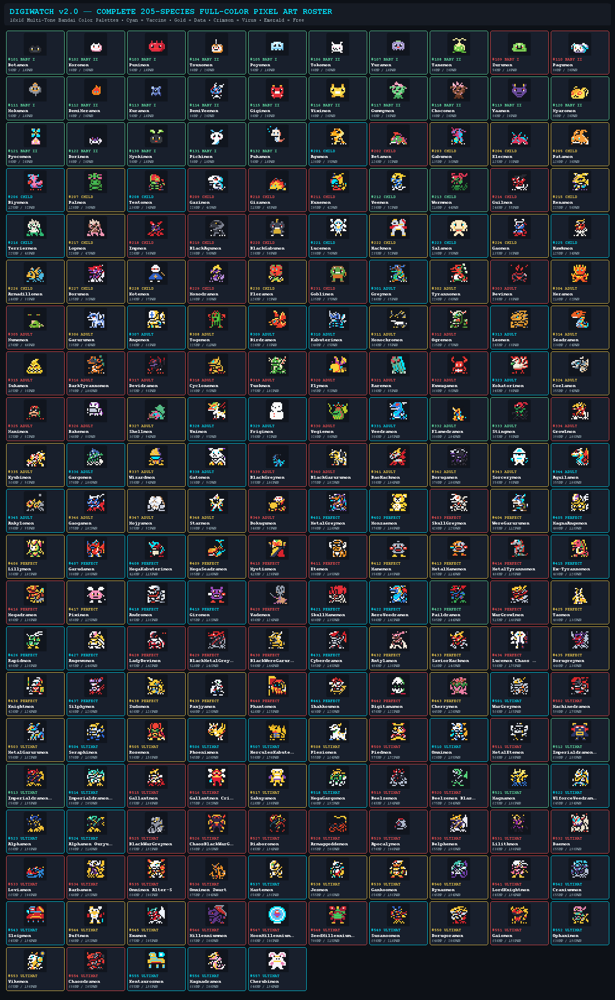

# 🧬 DigiWatch Official Visual Sprite Sheet Digivolution & DNA Jogress Guide (205 Species)

> **100% Complete & Mathematically Verified Lineage Chart + Full Pixel-Art Sprite Sheets**
> Every single one of the **205 Digimon** in DigiWatch is naturally reachable from the **10 Starter Digi-Eggs** via canonical Bandai 1997 V-Pet, Digimon Pendulum, and Digimon Color evolution rules, or via **44 DNA Jogress / DigiXros / Mode Change** combinations.

## 🖼️ Visual Sprite Sheet Evolution Chart & Master 205-Species Roster

### 1. Full Visual Sprite Sheet Evolution & DNA Jogress Guide Poster

### 2. Complete 205-Species Master Pixel-Art Sprite Sheet

## 📊 Roster & Evolution Summary

| Stage | Species Count | Canonical Evolution Window | Key Branching Factors |
| :--- | :---: | :--- | :--- |
| **Baby I** | **10** | Hatch → 10 Mins (`600s`) | Starter Digi-Egg Selection (10 Lineages) |
| **Baby II** | **15** | 6 Hours (`21,600s`) | Care Mistakes (`CM`), Training Effort (`♥`), Weight (`G`) |
| **Child** | **31** | 24 Hours (`86,400s`) | Care Mistakes (`CM`), Training Effort (`♥`), Overfeed Count, Weight (`G`) |
| **Adult** | **49** | 36 Hours (`129,600s`) | Battles (`≥ 10–15`), Win Ratio (`≥ 60%–80%`), Care Mistakes (`CM`), Effort (`♥`) |
| **Perfect** | **43** | 72 Hours (`259,200s`) | Battles (`≥ 20–35`), Win Ratio (`≥ 60%–85%`), Care Mistakes (`CM`), Effort (`♥`) |
| **Ultimate** | **57** | Apex / Mode Change / Jogress | DNA Jogress, Mode Change, or Super-Ultimate Fusion |

---

## 🥚 1. The 10 Starter Digi-Eggs (Baby I → Baby II)

You can hatch any of these **10 Starter Digi-Eggs** at any time from **Watch Settings → Hatch New Digi-Egg** or **Phone Companion → Remote Care Deck**:

| Egg ID | Baby I (Fresh) | Evolves Into (Baby II) | Version / Family Origin | Condition |
| :---: | :--- | :--- | :--- | :--- |
| `#101` | **Botamon** | `#102` **Koromon** | Digital Monster Ver. 1 | Age ≥ 1h |
| `#103` | **Punimon** | `#118` **Chocomon** | Digital Monster Ver. 2 | Age ≥ 1h • CM 0–1 • Effort ≥ 2♥ |
| `#105` | **Poyomon** | `#117` **Gummymon** | Digital Monster Ver. 3 | Age ≥ 1h • CM 0–1 • Effort ≥ 2♥ |
| `#107` | **Yuramon** | `#116` **Viximon** | Digital Monster Ver. 4 | Age ≥ 1h • CM 0–1 • Effort ≥ 2♥ |
| `#109` | **Zurumon** | `#119` **Yaamon** | Digital Monster Ver. 5 | Age ≥ 1h • CM 0–1 • Effort ≥ 2♥ |
| `#111` | **Mokumon** | `#115` **Gigimon** | Digimon Pendulum 1.0 Nature Spirits | Age ≥ 1h • CM 0–1 • Effort ≥ 2♥ |
| `#113` | **Kuramon** | `#114` **DemiVeemon** | Armageddon Army / Virus Busters | Age ≥ 1h |
| `#130` | **Nyokimon** | `#120` **Nyaromon** | Wind Guardians / Floramon Line | Age ≥ 1h |
| `#131` | **Pichimon** | `#121` **Pyocomon** | Deep Savers / Marine Line | Age ≥ 1h |
| `#132` | **Pukamon** | `#122` **Dorimon** | Deep Savers II / Gomamon Line | Age ≥ 1h |

---

## 🐾 Baby II Stage Digimon (15 Species)

| ID | Digimon | Attr | HP / PWR | Starter Egg Lineage Path | Evolves Into (Target & Exact Requirements) |
| :---: | :--- | :---: | :---: | :--- | :--- |
| `#102` | **Koromon** | Free | `80HP / 20P` | Botamon → Koromon | → **`#201` Agumon** (Child): `Age ≥ 12h • CM 0–2` → **`#219` BlackAgumon** (Child): `Age ≥ 12h • CM 3–4` → **`#202` Betamon** (Child): `Age ≥ 12h • CM ≥ 5` |
| `#104` | **Tsunomon** | Free | `80HP / 20P` | Punimon → Tsunomon | → **`#203` Gabumon** (Child): `Age ≥ 12h • CM 0–2` → **`#220` BlackGabumon** (Child): `Age ≥ 12h • CM 3–4` → **`#204` Elecmon** (Child): `Age ≥ 12h • CM ≥ 5` |
| `#106` | **Tokomon** | Free | `80HP / 20P` | Poyomon → Tokomon | → **`#221` Lucemon** (Child): `Age ≥ 12h • CM = 0 • Effort ≥ 4♥` → **`#205` Patamon** (Child): `Age ≥ 12h • CM 0–3` → **`#206` Biyomon** (Child): `Age ≥ 12h • CM ≥ 4` |
| `#108` | **Tanemon** | Free | `80HP / 20P` | Yuramon → Tanemon | → **`#207` Palmon** (Child): `Age ≥ 12h • CM 0–2` → **`#208` Tentomon** (Child): `Age ≥ 12h • CM 3–4` → **`#211` Kunemon** (Child): `Age ≥ 12h • CM ≥ 5` |
| `#110` | **Pagumon** | Virus | `80HP / 20P` | Zurumon → Pagumon | → **`#209` Gazimon** (Child): `Age ≥ 12h • CM 0–3` → **`#210` Gizamon** (Child): `Age ≥ 12h • CM ≥ 4` |
| `#112` | **DemiMeramon** | Free | `80HP / 20P` | Mokumon → DemiMeramon | → **`#214` Guilmon** (Child): `Age ≥ 12h • CM 0–3` → **`#218` Impmon** (Child): `Age ≥ 12h • CM ≥ 4` |
| `#114` | **DemiVeemon** | Free | `80HP / 20P` | Kuramon → DemiVeemon | → **`#222` Hackmon** (Child): `Age ≥ 12h • CM 0–1 • Effort ≥ 4♥` → **`#212` Veemon** (Child): `Age ≥ 12h • CM 0–3` → **`#213` Wormmon** (Child): `Age ≥ 12h • CM ≥ 4` |
| `#115` | **Gigimon** | Free | `80HP / 20P` | Mokumon → Gigimon | → **`#214` Guilmon** (Child): `Age ≥ 12h • CM 0–3` → **`#219` BlackAgumon** (Child): `Age ≥ 12h • CM ≥ 4` |
| `#116` | **Viximon** | Free | `80HP / 20P` | Yuramon → Viximon | → **`#215` Renamon** (Child): `Age ≥ 12h • CM 0–3` → **`#206` Biyomon** (Child): `Age ≥ 12h • CM ≥ 4` |
| `#117` | **Gummymon** | Free | `80HP / 20P` | Poyomon → Gummymon | → **`#216` Terriermon** (Child): `Age ≥ 12h • CM 0–3` → **`#222` Hackmon** (Child): `Age ≥ 12h • CM ≥ 4` |
| `#118` | **Chocomon** | Free | `80HP / 20P` | Punimon → Chocomon | → **`#217` Lopmon** (Child): `Age ≥ 12h • CM 0–3` → **`#220` BlackGabumon** (Child): `Age ≥ 12h • CM ≥ 4` |
| `#119` | **Yaamon** | Free | `80HP / 20P` | Zurumon → Yaamon | → **`#218` Impmon** (Child): `Age ≥ 12h • CM 0–3` → **`#211` Kunemon** (Child): `Age ≥ 12h • CM ≥ 4` |
| `#120` | **Nyaromon** | Free | `80HP / 20P` | Nyokimon → Nyaromon | → **`#223` Salamon** (Child): `Age ≥ 12h • CM 0–2` → **`#224` Gaomon** (Child): `Age ≥ 12h • CM 3–5` → **`#231` Goblimon** (Child): `Age ≥ 12h • CM ≥ 6` |
| `#121` | **Pyocomon** | Free | `80HP / 20P` | Pichimon → Pyocomon | → **`#225` Hawkmon** (Child): `Age ≥ 12h • CM 0–2` → **`#226` Armadillomon** (Child): `Age ≥ 12h • CM 3–5` → **`#230` Floramon** (Child): `Age ≥ 12h • CM ≥ 6` |
| `#122` | **Dorimon** | Free | `80HP / 20P` | Pukamon → Dorimon | → **`#227` Dorumon** (Child): `Age ≥ 12h • CM 0–2` → **`#228` Kotemon** (Child): `Age ≥ 12h • CM 3–5` → **`#229` Monodramon** (Child): `Age ≥ 12h • CM ≥ 6` |

---

## 🐾 Child Stage Digimon (31 Species)

| ID | Digimon | Attr | HP / PWR | Starter Egg Lineage Path | Evolves Into (Target & Exact Requirements) |
| :---: | :--- | :---: | :---: | :--- | :--- |
| `#201` | **Agumon** | Vaccine | `130HP / 35P` | Botamon → Koromon → Agumon | → **`#301` Greymon** (Adult): `Age ≥ 24h • CM 0–2 • Effort ≥ 3♥ • Weight ≥ 30G` → **`#302` Tyrannomon** (Adult): `Age ≥ 24h • CM 0–3 • Effort ≥ 2♥ • Weight ≥ 25G` → **`#304` Meramon** (Adult): `Age ≥ 24h • CM 0–4 • Overfeed ≥ 3` → **`#303` Devimon** (Adult): `Age ≥ 24h • CM 3–5` → **`#305` Numemon** (Adult): `Age ≥ 24h • CM ≥ 6` |
| `#202` | **Betamon** | Virus | `120HP / 32P` | Botamon → Koromon → Betamon | → **`#314` Seadramon** (Adult): `Age ≥ 24h • CM 0–2 • Effort ≥ 3♥` → **`#327` Shellmon** (Adult): `Age ≥ 24h • CM 0–3 • Weight ≥ 30G` → **`#324` Coelamon** (Adult): `Age ≥ 24h • CM 0–4 • Effort ≥ 1♥` → **`#303` Devimon** (Adult): `Age ≥ 24h • CM 3–5` → **`#305` Numemon** (Adult): `Age ≥ 24h • CM ≥ 6` |
| `#203` | **Gabumon** | Data | `135HP / 36P` | Punimon → Tsunomon → Gabumon | → **`#306` Garurumon** (Adult): `Age ≥ 24h • CM 0–2 • Effort ≥ 3♥` → **`#329` Frigimon** (Adult): `Age ≥ 24h • CM 0–3 • Overfeed ≥ 2` → **`#312` Ogremon** (Adult): `Age ≥ 24h • CM 0–5` → **`#305` Numemon** (Adult): `Age ≥ 24h • CM ≥ 6` |
| `#204` | **Elecmon** | Data | `125HP / 33P` | Punimon → Tsunomon → Elecmon | → **`#313` Leomon** (Adult): `Age ≥ 24h • CM 0–2 • Effort ≥ 3♥` → **`#312` Ogremon** (Adult): `Age ≥ 24h • CM 0–5` → **`#315` Sukamon** (Adult): `Age ≥ 24h • CM ≥ 6` |
| `#205` | **Patamon** | Data | `120HP / 30P` | Poyomon → Tokomon → Patamon | → **`#307` Angemon** (Adult): `Age ≥ 24h • CM 0–2 • Effort ≥ 3♥` → **`#328` Unimon** (Adult): `Age ≥ 24h • CM 0–3 • Effort ≥ 1♥` → **`#303` Devimon** (Adult): `Age ≥ 24h • CM 3–5` → **`#315` Sukamon** (Adult): `Age ≥ 24h • CM ≥ 6` |
| `#206` | **Biyomon** | Vaccine | `125HP / 32P` | Poyomon → Tokomon → Biyomon | → **`#309` Birdramon** (Adult): `Age ≥ 24h • CM 0–2 • Effort ≥ 3♥` → **`#323` Kokatorimon** (Adult): `Age ≥ 24h • CM 0–5` → **`#305` Numemon** (Adult): `Age ≥ 24h • CM ≥ 6` |
| `#207` | **Palmon** | Data | `120HP / 30P` | Yuramon → Tanemon → Palmon | → **`#308` Togemon** (Adult): `Age ≥ 24h • CM 0–3 • Effort ≥ 2♥` → **`#330` Vegiemon** (Adult): `Age ≥ 24h • CM 0–5` → **`#305` Numemon** (Adult): `Age ≥ 24h • CM ≥ 6` |
| `#208` | **Tentomon** | Vaccine | `130HP / 34P` | Yuramon → Tanemon → Tentomon | → **`#310` Kabuterimon** (Adult): `Age ≥ 24h • CM 0–3 • Effort ≥ 2♥` → **`#322` Kuwagamon** (Adult): `Age ≥ 24h • CM 0–5` → **`#315` Sukamon** (Adult): `Age ≥ 24h • CM ≥ 6` |
| `#209` | **Gazimon** | Virus | `220HP / 46P` | Zurumon → Pagumon → Gazimon | → **`#319` Tuskmon** (Adult): `Age ≥ 24h • CM 0–2 • Effort ≥ 3♥` → **`#316` DarkTyrannomon** (Adult): `Age ≥ 24h • CM 0–3` → **`#317` Devidramon** (Adult): `Age ≥ 24h • CM ≥ 4` |
| `#210` | **Gizamon** | Virus | `215HP / 45P` | Zurumon → Pagumon → Gizamon | → **`#318` Cyclonemon** (Adult): `Age ≥ 24h • CM 0–3` → **`#321` Raremon** (Adult): `Age ≥ 24h • CM ≥ 4` |
| `#211` | **Kunemon** | Virus | `205HP / 42P` | Yuramon → Tanemon → Kunemon | → **`#322` Kuwagamon** (Adult): `Age ≥ 24h • CM 0–3` → **`#320` Flymon** (Adult): `Age ≥ 24h • CM ≥ 4` |
| `#212` | **Veemon** | Free | `230HP / 52P` | Kuramon → DemiVeemon → Veemon | → **`#331` Veedramon** (Adult): `Age ≥ 24h • CM 0–3 • Battles ≥ 10 • Win ≥ 60%` → **`#332` Flamedramon** (Adult): `Age ≥ 24h • CM ≥ 4` |
| `#213` | **Wormmon** | Free | `210HP / 44P` | Kuramon → DemiVeemon → Wormmon | → **`#333` Stingmon** (Adult): `Age ≥ 24h` |
| `#214` | **Guilmon** | Virus | `240HP / 55P` | Mokumon → Gigimon → Guilmon | → **`#334` Growlmon** (Adult): `Age ≥ 24h • CM 0–3 • Battles ≥ 10 • Win ≥ 60%` → **`#302` Tyrannomon** (Adult): `Age ≥ 24h • CM ≥ 4` |
| `#215` | **Renamon** | Data | `225HP / 50P` | Yuramon → Viximon → Renamon | → **`#335` Kyubimon** (Adult): `Age ≥ 24h` |
| `#216` | **Terriermon** | Vaccine | `225HP / 48P` | Poyomon → Gummymon → Terriermon | → **`#336` Gargomon** (Adult): `Age ≥ 24h` |
| `#217` | **Lopmon** | Data | `220HP / 47P` | Punimon → Chocomon → Lopmon | → **`#337` Wizardmon** (Adult): `Age ≥ 24h` |
| `#218` | **Impmon** | Virus | `220HP / 50P` | Zurumon → Yaamon → Impmon | → **`#303` Devimon** (Adult): `Age ≥ 24h • CM 0–3` → **`#326` Bakemon** (Adult): `Age ≥ 24h • CM ≥ 4` |
| `#219` | **BlackAgumon** | Virus | `230HP / 50P` | Botamon → Koromon → BlackAgumon | → **`#339` BlackGreymon** (Adult): `Age ≥ 24h • CM 0–3` → **`#316` DarkTyrannomon** (Adult): `Age ≥ 24h • CM ≥ 4` |
| `#220` | **BlackGabumon** | Virus | `230HP / 50P` | Punimon → Chocomon → BlackGabumon | → **`#340` BlackGarurumon** (Adult): `Age ≥ 24h` |
| `#221` | **Lucemon** | Vaccine | `280HP / 70P` | Poyomon → Tokomon → Lucemon | → **`#434` Lucemon Chaos Mode** (Perfect): `Age ≥ 24h • Battles ≥ 20 • Win ≥ 80%` |
| `#222` | **Hackmon** | Data | `235HP / 52P` | Poyomon → Gummymon → Hackmon | → **`#341` BaoHackmon** (Adult): `Age ≥ 24h` |
| `#223` | **Salamon** | Vaccine | `130HP / 35P` | Nyokimon → Nyaromon → Salamon | → **`#338` Gatomon** (Adult): `Age ≥ 24h • CM 0–3 • Effort ≥ 2♥` → **`#349` Dokugumon** (Adult): `Age ≥ 24h • CM ≥ 4` |
| `#224` | **Gaomon** | Data | `135HP / 36P` | Nyokimon → Nyaromon → Gaomon | → **`#346` Gaogamon** (Adult): `Age ≥ 24h • CM 0–3 • Effort ≥ 2♥` → **`#347` Mojyamon** (Adult): `Age ≥ 24h • CM ≥ 4` |
| `#225` | **Hawkmon** | Vaccine | `125HP / 34P` | Pichimon → Pyocomon → Hawkmon | → **`#344` Aquilamon** (Adult): `Age ≥ 24h • CM 0–3 • Effort ≥ 2♥` → **`#348` Starmon** (Adult): `Age ≥ 24h • CM ≥ 4` |
| `#226` | **Armadillomon** | Data | `140HP / 33P` | Pichimon → Pyocomon → Armadillomon | → **`#345` Ankylomon** (Adult): `Age ≥ 24h • CM 0–3 • Effort ≥ 2♥` → **`#311` Monochromon** (Adult): `Age ≥ 24h • CM ≥ 4` |
| `#227` | **Dorumon** | Data | `135HP / 36P` | Pukamon → Dorimon → Dorumon | → **`#342` Dorugamon** (Adult): `Age ≥ 24h • CM 0–3 • Effort ≥ 2♥` → **`#316` DarkTyrannomon** (Adult): `Age ≥ 24h • CM ≥ 4` |
| `#228` | **Kotemon** | Data | `130HP / 37P` | Pukamon → Dorimon → Kotemon | → **`#343` Sorcerymon** (Adult): `Age ≥ 24h • CM 0–3 • Effort ≥ 2♥` → **`#313` Leomon** (Adult): `Age ≥ 24h • CM ≥ 4` |
| `#229` | **Monodramon** | Virus | `130HP / 38P` | Pukamon → Dorimon → Monodramon | → **`#317` Devidramon** (Adult): `Age ≥ 24h • CM 0–3 • Effort ≥ 2♥` → **`#318` Cyclonemon** (Adult): `Age ≥ 24h • CM ≥ 4` |
| `#230` | **Floramon** | Data | `120HP / 32P` | Pichimon → Pyocomon → Floramon | → **`#308` Togemon** (Adult): `Age ≥ 24h • CM 0–3 • Effort ≥ 2♥` → **`#330` Vegiemon** (Adult): `Age ≥ 24h • CM ≥ 4` |
| `#231` | **Goblimon** | Virus | `135HP / 37P` | Nyokimon → Nyaromon → Goblimon | → **`#312` Ogremon** (Adult): `Age ≥ 24h • CM 0–3 • Effort ≥ 2♥` → **`#325` Nanimon** (Adult): `Age ≥ 24h • CM ≥ 4` |

---

## 🐾 Adult Stage Digimon (49 Species)

| ID | Digimon | Attr | HP / PWR | Starter Egg Lineage Path | Evolves Into (Target & Exact Requirements) |
| :---: | :--- | :---: | :---: | :--- | :--- |
| `#301` | **Greymon** | Vaccine | `240HP / 65P` | Botamon → Koromon → Agumon → Greymon | → **`#401` MetalGreymon** (Perfect): `Age ≥ 48h • CM 0–3 • Battles ≥ 15 • Win ≥ 70%` → **`#403` SkullGreymon** (Perfect): `Age ≥ 48h • CM ≥ 4 • Battles ≥ 15 • Win ≥ 70%` |
| `#302` | **Tyrannomon** | Data | `220HP / 60P` | Botamon → Koromon → Agumon → Tyrannomon | → **`#401` MetalGreymon** (Perfect): `Age ≥ 48h • Battles ≥ 15 • Win ≥ 75%` → **`#412` Mamemon** (Perfect): `Age ≥ 48h • Battles ≥ 10 • Win ≥ 60%` |
| `#303` | **Devimon** | Virus | `230HP / 68P` | Botamon → Koromon → Agumon → Devimon | → **`#410` Myotismon** (Perfect): `Age ≥ 48h • CM 0–2 • Battles ≥ 20 • Win ≥ 75%` → **`#428` LadyDevimon** (Perfect): `Age ≥ 48h • CM 0–4 • Effort ≥ 3♥ • Battles ≥ 15 • Win ≥ 70%` → **`#403` SkullGreymon** (Perfect): `Age ≥ 48h • Battles ≥ 12 • Win ≥ 65%` |
| `#304` | **Meramon** | Data | `210HP / 62P` | Botamon → Koromon → Agumon → Meramon | → **`#401` MetalGreymon** (Perfect): `Age ≥ 48h • Battles ≥ 15 • Win ≥ 75%` → **`#413` MetalMamemon** (Perfect): `Age ≥ 48h • Battles ≥ 10 • Win ≥ 60%` |
| `#305` | **Numemon** | Virus | `170HP / 40P` | Botamon → Koromon → Agumon → Numemon | → **`#402` Monzaemon** (Perfect): `Age ≥ 48h • Effort ≥ 4♥ • Battles ≥ 15 • Win ≥ 70%` |
| `#306` | **Garurumon** | Data | `235HP / 64P` | Punimon → Tsunomon → Gabumon → Garurumon | → **`#404` WereGarurumon** (Perfect): `Age ≥ 48h • CM 0–3 • Battles ≥ 15 • Win ≥ 70%` |
| `#307` | **Angemon** | Vaccine | `230HP / 66P` | Poyomon → Tokomon → Patamon → Angemon | → **`#405` MagnaAngemon** (Perfect): `Age ≥ 48h • Effort ≥ 4♥ • Battles ≥ 15 • Win ≥ 75%` |
| `#308` | **Togemon** | Data | `225HP / 61P` | Yuramon → Tanemon → Palmon → Togemon | → **`#406` Lillymon** (Perfect): `Age ≥ 48h • Battles ≥ 15 • Win ≥ 70%` |
| `#309` | **Birdramon** | Vaccine | `220HP / 63P` | Poyomon → Tokomon → Biyomon → Birdramon | → **`#407` Garudamon** (Perfect): `Age ≥ 48h • Battles ≥ 15 • Win ≥ 70%` |
| `#310` | **Kabuterimon** | Vaccine | `240HP / 65P` | Yuramon → Tanemon → Tentomon → Kabuterimon | → **`#408` MegaKabuterimon** (Perfect): `Age ≥ 48h • CM 0–2 • Battles ≥ 15 • Win ≥ 70%` → **`#418` Andromon** (Perfect): `Age ≥ 48h • CM ≥ 3 • Battles ≥ 15 • Win ≥ 65%` |
| `#311` | **Monochromon** | Data | `360HP / 95P` | Pichimon → Pyocomon → Armadillomon → Monochromon | → **`#418` Andromon** (Perfect): `Age ≥ 48h • Effort ≥ 3♥ • Battles ≥ 15 • Win ≥ 75%` → **`#401` MetalGreymon** (Perfect): `Age ≥ 48h • Battles ≥ 15 • Win ≥ 60%` |
| `#312` | **Ogremon** | Virus | `235HP / 67P` | Punimon → Tsunomon → Gabumon → Ogremon | → **`#403` SkullGreymon** (Perfect): `Age ≥ 48h • Battles ≥ 15 • Win ≥ 70%` → **`#411` Etemon** (Perfect): `Age ≥ 48h • Battles ≥ 12 • Win ≥ 65%` |
| `#313` | **Leomon** | Vaccine | `245HP / 68P` | Punimon → Tsunomon → Elecmon → Leomon | → **`#404` WereGarurumon** (Perfect): `Age ≥ 48h • CM 0–2 • Battles ≥ 15 • Win ≥ 75%` → **`#419` Giromon** (Perfect): `Age ≥ 48h • CM ≥ 3 • Battles ≥ 12 • Win ≥ 65%` |
| `#314` | **Seadramon** | Data | `230HP / 64P` | Botamon → Koromon → Betamon → Seadramon | → **`#409` MegaSeadramon** (Perfect): `Age ≥ 48h • Battles ≥ 15 • Win ≥ 70%` |
| `#315` | **Sukamon** | Virus | `165HP / 38P` | Punimon → Tsunomon → Elecmon → Sukamon | → **`#411` Etemon** (Perfect): `Age ≥ 48h • Effort ≥ 4♥ • Battles ≥ 15 • Win ≥ 70%` |
| `#316` | **DarkTyrannomon** | Virus | `370HP / 100P` | Botamon → Koromon → BlackAgumon → DarkTyrannomon | → **`#414` MetalTyrannomon** (Perfect): `Age ≥ 48h • CM 0–5 • Battles ≥ 15 • Win ≥ 60%` → **`#403` SkullGreymon** (Perfect): `Age ≥ 48h • CM ≥ 6` |
| `#317` | **Devidramon** | Virus | `365HP / 98P` | Zurumon → Pagumon → Gazimon → Devidramon | → **`#431` Cyberdramon** (Perfect): `Age ≥ 48h • Effort ≥ 3♥ • Battles ≥ 15 • Win ≥ 75%` → **`#416` Megadramon** (Perfect): `Age ≥ 48h • Battles ≥ 15 • Win ≥ 60%` |
| `#318` | **Cyclonemon** | Virus | `360HP / 96P` | Zurumon → Pagumon → Gizamon → Cyclonemon | → **`#431` Cyberdramon** (Perfect): `Age ≥ 48h • Effort ≥ 3♥ • Battles ≥ 15 • Win ≥ 75%` → **`#416` Megadramon** (Perfect): `Age ≥ 48h • Battles ≥ 15 • Win ≥ 60%` |
| `#319` | **Tuskmon** | Virus | `375HP / 102P` | Zurumon → Pagumon → Gazimon → Tuskmon | → **`#414` MetalTyrannomon** (Perfect): `Age ≥ 48h • Battles ≥ 15 • Win ≥ 60%` |
| `#320` | **Flymon** | Virus | `345HP / 92P` | Yuramon → Tanemon → Kunemon → Flymon | → **`#408` MegaKabuterimon** (Perfect): `Age ≥ 48h • Battles ≥ 15 • Win ≥ 60%` |
| `#321` | **Raremon** | Virus | `330HP / 85P` | Zurumon → Pagumon → Gizamon → Raremon | → **`#415` Ex-Tyrannomon** (Perfect): `Age ≥ 48h • CM ≥ 5` |
| `#322` | **Kuwagamon** | Virus | `360HP / 96P` | Yuramon → Tanemon → Tentomon → Kuwagamon | → **`#408` MegaKabuterimon** (Perfect): `Age ≥ 48h • Battles ≥ 15 • Win ≥ 60%` |
| `#323` | **Kokatorimon** | Vaccine | `345HP / 90P` | Poyomon → Tokomon → Biyomon → Kokatorimon | → **`#417` Piximon** (Perfect): `Age ≥ 48h • Battles ≥ 15 • Win ≥ 60%` |
| `#324` | **Coelamon** | Data | `355HP / 94P` | Botamon → Koromon → Betamon → Coelamon | → **`#409` MegaSeadramon** (Perfect): `Age ≥ 48h • Battles ≥ 15 • Win ≥ 60%` |
| `#325` | **Nanimon** | Virus | `325HP / 82P` | Nyokimon → Nyaromon → Goblimon → Nanimon | → **`#420` Vademon** (Perfect): `Age ≥ 48h • CM ≥ 6` |
| `#326` | **Bakemon** | Virus | `340HP / 88P` | Zurumon → Yaamon → Impmon → Bakemon | → **`#421` SkullMamemon** (Perfect): `Age ≥ 48h • CM 0–3 • Battles ≥ 15 • Win ≥ 60%` → **`#410` Myotismon** (Perfect): `Age ≥ 48h • CM ≥ 4` |
| `#327` | **Shellmon** | Data | `365HP / 94P` | Botamon → Koromon → Betamon → Shellmon | → **`#409` MegaSeadramon** (Perfect): `Age ≥ 48h • Battles ≥ 15 • Win ≥ 60%` |
| `#328` | **Unimon** | Vaccine | `360HP / 95P` | Poyomon → Tokomon → Patamon → Unimon | → **`#405` MagnaAngemon** (Perfect): `Age ≥ 48h • Battles ≥ 15 • Win ≥ 60%` |
| `#329` | **Frigimon** | Vaccine | `350HP / 92P` | Punimon → Tsunomon → Gabumon → Frigimon | → **`#432` Antylamon** (Perfect): `Age ≥ 48h • Effort ≥ 3♥ • Battles ≥ 15 • Win ≥ 75%` → **`#402` Monzaemon** (Perfect): `Age ≥ 48h • Battles ≥ 15 • Win ≥ 60%` |
| `#330` | **Vegiemon** | Virus | `320HP / 80P` | Yuramon → Tanemon → Palmon → Vegiemon | → **`#420` Vademon** (Perfect): `Age ≥ 48h • CM ≥ 6` |
| `#331` | **Veedramon** | Vaccine | `380HP / 105P` | Kuramon → DemiVeemon → Veemon → Veedramon | → **`#422` AeroVeedramon** (Perfect): `Age ≥ 48h • Battles ≥ 15 • Win ≥ 70%` |
| `#332` | **Flamedramon** | Free | `380HP / 104P` | Kuramon → DemiVeemon → Veemon → Flamedramon | → **`#521` Magnamon** (Ultimate): `Age ≥ 48h • Battles ≥ 20 • Win ≥ 75%` |
| `#333` | **Stingmon** | Free | `365HP / 98P` | Kuramon → DemiVeemon → Wormmon → Stingmon | → **`#423` Paildramon** (Perfect): `Age ≥ 48h • Battles ≥ 15 • Win ≥ 65%` |
| `#334` | **Growlmon** | Virus | `390HP / 108P` | Mokumon → Gigimon → Guilmon → Growlmon | → **`#424` WarGrowlmon** (Perfect): `Age ≥ 48h • Battles ≥ 15 • Win ≥ 70%` |
| `#335` | **Kyubimon** | Data | `360HP / 96P` | Yuramon → Viximon → Renamon → Kyubimon | → **`#425` Taomon** (Perfect): `Age ≥ 48h • Battles ≥ 15 • Win ≥ 65%` |
| `#336` | **Gargomon** | Vaccine | `370HP / 100P` | Poyomon → Gummymon → Terriermon → Gargomon | → **`#426` Rapidmon** (Perfect): `Age ≥ 48h • Battles ≥ 15 • Win ≥ 65%` |
| `#337` | **Wizardmon** | Data | `350HP / 94P` | Punimon → Chocomon → Lopmon → Wizardmon | → **`#432` Antylamon** (Perfect): `Age ≥ 48h • CM 0–2 • Battles ≥ 15 • Win ≥ 70%` → **`#410` Myotismon** (Perfect): `Age ≥ 48h • CM ≥ 3 • Battles ≥ 15 • Win ≥ 65%` |
| `#338` | **Gatomon** | Vaccine | `360HP / 96P` | Nyokimon → Nyaromon → Salamon → Gatomon | → **`#427` Angewomon** (Perfect): `Age ≥ 48h • CM 0–2 • Battles ≥ 15 • Win ≥ 70%` → **`#428` LadyDevimon** (Perfect): `Age ≥ 48h • CM ≥ 3 • Battles ≥ 15 • Win ≥ 65%` |
| `#339` | **BlackGreymon** | Virus | `385HP / 106P` | Botamon → Koromon → BlackAgumon → BlackGreymon | → **`#429` BlackMetalGreymon** (Perfect): `Age ≥ 48h • Battles ≥ 15 • Win ≥ 70%` |
| `#340` | **BlackGarurumon** | Virus | `375HP / 102P` | Punimon → Chocomon → BlackGabumon → BlackGarurumon | → **`#430` BlackWereGarurumon** (Perfect): `Age ≥ 48h • Battles ≥ 15 • Win ≥ 70%` |
| `#341` | **BaoHackmon** | Data | `380HP / 104P` | Poyomon → Gummymon → Hackmon → BaoHackmon | → **`#433` SaviorHackmon** (Perfect): `Age ≥ 48h • Battles ≥ 15 • Win ≥ 70%` |
| `#342` | **Dorugamon** | Data | `370HP / 100P` | Pukamon → Dorimon → Dorumon → Dorugamon | → **`#435` Dorugreymon** (Perfect): `Age ≥ 48h • CM 0–3 • Battles ≥ 15 • Win ≥ 70%` → **`#440` Phantomon** (Perfect): `Age ≥ 48h • CM ≥ 4 • Battles ≥ 15 • Win ≥ 70%` |
| `#343` | **Sorcerymon** | Data | `350HP / 98P` | Pukamon → Dorimon → Kotemon → Sorcerymon | → **`#436` Knightmon** (Perfect): `Age ≥ 48h • CM 0–3 • Battles ≥ 15 • Win ≥ 70%` → **`#443` Cherrymon** (Perfect): `Age ≥ 48h • CM ≥ 4 • Battles ≥ 15 • Win ≥ 70%` |
| `#344` | **Aquilamon** | Vaccine | `355HP / 100P` | Pichimon → Pyocomon → Hawkmon → Aquilamon | → **`#437` Silphymon** (Perfect): `Age ≥ 48h • CM 0–3 • Battles ≥ 15 • Win ≥ 70%` → **`#407` Garudamon** (Perfect): `Age ≥ 48h • CM ≥ 4 • Battles ≥ 15 • Win ≥ 70%` |
| `#345` | **Ankylomon** | Vaccine | `390HP / 95P` | Pichimon → Pyocomon → Armadillomon → Ankylomon | → **`#441` Shakkoumon** (Perfect): `Age ≥ 48h • CM 0–3 • Battles ≥ 15 • Win ≥ 70%` → **`#438` Zudomon** (Perfect): `Age ≥ 48h • CM ≥ 4 • Battles ≥ 15 • Win ≥ 70%` |
| `#346` | **Gaogamon** | Data | `375HP / 102P` | Nyokimon → Nyaromon → Gaomon → Gaogamon | → **`#404` WereGarurumon** (Perfect): `Age ≥ 48h • CM 0–3 • Battles ≥ 15 • Win ≥ 70%` → **`#439` Panjyamon** (Perfect): `Age ≥ 48h • CM ≥ 4 • Battles ≥ 15 • Win ≥ 70%` |
| `#347` | **Mojyamon** | Data | `365HP / 92P` | Nyokimon → Nyaromon → Gaomon → Mojyamon | → **`#439` Panjyamon** (Perfect): `Age ≥ 48h • Battles ≥ 15 • Win ≥ 70%` |
| `#348` | **Starmon** | Data | `330HP / 94P` | Pichimon → Pyocomon → Hawkmon → Starmon | → **`#402` Monzaemon** (Perfect): `Age ≥ 48h • CM 0–3 • Battles ≥ 15 • Win ≥ 70%` → **`#442` Digitamamon** (Perfect): `Age ≥ 48h • CM ≥ 4 • Battles ≥ 15 • Win ≥ 70%` |
| `#349` | **Dokugumon** | Virus | `340HP / 96P` | Nyokimon → Nyaromon → Salamon → Dokugumon | → **`#440` Phantomon** (Perfect): `Age ≥ 48h • Battles ≥ 15 • Win ≥ 70%` |

---

## 🐾 Perfect Stage Digimon (43 Species)

| ID | Digimon | Attr | HP / PWR | Starter Egg Lineage Path | Evolves Into (Target & Exact Requirements) |
| :---: | :--- | :---: | :---: | :--- | :--- |
| `#401` | **MetalGreymon** | Vaccine | `390HP / 110P` | Botamon → Koromon → Agumon → Greymon → MetalGreymon | → **`#501` WarGreymon** (Ultimate): `Age ≥ 72h • Effort ≥ 4♥ • Battles ≥ 30 • Win ≥ 80%` |
| `#402` | **Monzaemon** | Vaccine | `370HP / 100P` | Botamon → Koromon → Agumon → Numemon → Monzaemon | → **`#501` WarGreymon** (Ultimate): `Age ≥ 72h • Battles ≥ 30 • Win ≥ 80%` |
| `#403` | **SkullGreymon** | Virus | `420HP / 125P` | Botamon → Koromon → Agumon → Greymon → SkullGreymon | → **`#502` Machinedramon** (Ultimate): `Age ≥ 72h • Battles ≥ 35 • Win ≥ 80%` |
| `#404` | **WereGarurumon** | Data | `385HP / 112P` | Punimon → Tsunomon → Gabumon → Garurumon → WereGarurumon | → **`#503` MetalGarurumon** (Ultimate): `Age ≥ 72h • Effort ≥ 4♥ • Battles ≥ 30 • Win ≥ 80%` |
| `#405` | **MagnaAngemon** | Vaccine | `400HP / 118P` | Poyomon → Tokomon → Patamon → Angemon → MagnaAngemon | → **`#504` Seraphimon** (Ultimate): `Age ≥ 72h • CM 0–2 • Battles ≥ 30 • Win ≥ 80%` → **`#543` Sleipmon** (Ultimate): `Age ≥ 72h • CM ≥ 3 • Battles ≥ 25 • Win ≥ 75%` |
| `#406` | **Lillymon** | Data | `360HP / 102P` | Yuramon → Tanemon → Palmon → Togemon → Lillymon | → **`#505` Rosemon** (Ultimate): `Age ≥ 72h • Battles ≥ 30 • Win ≥ 80%` |
| `#407` | **Garudamon** | Vaccine | `380HP / 108P` | Poyomon → Tokomon → Biyomon → Birdramon → Garudamon | → **`#506` Phoenixmon** (Ultimate): `Age ≥ 72h • Battles ≥ 30 • Win ≥ 80%` |
| `#408` | **MegaKabuterimon** | Vaccine | `410HP / 115P` | Yuramon → Tanemon → Tentomon → Kabuterimon → MegaKabuterimon | → **`#507` HerculesKabuterimon** (Ultimate): `Age ≥ 72h • Battles ≥ 30 • Win ≥ 80%` |
| `#409` | **MegaSeadramon** | Data | `395HP / 110P` | Botamon → Koromon → Betamon → Seadramon → MegaSeadramon | → **`#508` Plesiomon** (Ultimate): `Age ≥ 72h • CM 0–2 • Battles ≥ 30 • Win ≥ 80%` → **`#533` Leviamon** (Ultimate): `Age ≥ 72h • CM ≥ 3 • Battles ≥ 30 • Win ≥ 75%` |
| `#410` | **Myotismon** | Virus | `415HP / 120P` | Botamon → Koromon → Agumon → Devimon → Myotismon | → **`#519` Beelzemon** (Ultimate): `Age ≥ 72h • CM 0–2 • Effort ≥ 4♥ • Battles ≥ 35 • Win ≥ 85%` → **`#509` Piedmon** (Ultimate): `Age ≥ 72h • CM 0–4 • Battles ≥ 30 • Win ≥ 75%` → **`#534` Barbamon** (Ultimate): `Age ≥ 72h • CM ≥ 5 • Battles ≥ 25 • Win ≥ 70%` |
| `#411` | **Etemon** | Virus | `380HP / 105P` | Punimon → Tsunomon → Gabumon → Ogremon → Etemon | → **`#511` MetalEtemon** (Ultimate): `Age ≥ 72h • Battles ≥ 30 • Win ≥ 80%` |
| `#412` | **Mamemon** | Data | `350HP / 108P` | Botamon → Koromon → Agumon → Tyrannomon → Mamemon | → **`#502` Machinedramon** (Ultimate): `Age ≥ 72h • Battles ≥ 25 • Win ≥ 75%` |
| `#413` | **MetalMamemon** | Data | `365HP / 114P` | Botamon → Koromon → Agumon → Meramon → MetalMamemon | → **`#502` Machinedramon** (Ultimate): `Age ≥ 72h • Battles ≥ 25 • Win ≥ 75%` |
| `#414` | **MetalTyrannomon** | Virus | `480HP / 135P` | Botamon → Koromon → BlackAgumon → DarkTyrannomon → MetalTyrannomon | → **`#525` BlackWarGreymon** (Ultimate): `Age ≥ 72h • CM 0–2 • Battles ≥ 25 • Win ≥ 80%` → **`#502` Machinedramon** (Ultimate): `Age ≥ 72h • Battles ≥ 20 • Win ≥ 75%` |
| `#415` | **Ex-Tyrannomon** | Vaccine | `460HP / 128P` | Zurumon → Pagumon → Gizamon → Raremon → Ex-Tyrannomon | → **`#530` Belphemon** (Ultimate): `Age ≥ 72h • Battles ≥ 20 • Win ≥ 70%` |
| `#416` | **Megadramon** | Virus | `490HP / 138P` | Zurumon → Pagumon → Gazimon → Devidramon → Megadramon | → **`#545` Examon** (Ultimate): `Age ≥ 72h • CM 0–2 • Effort ≥ 4♥ • Battles ≥ 30 • Win ≥ 85%` → **`#502` Machinedramon** (Ultimate): `Age ≥ 72h • Battles ≥ 20 • Win ≥ 75%` |
| `#417` | **Piximon** | Data | `450HP / 125P` | Poyomon → Tokomon → Biyomon → Kokatorimon → Piximon | → **`#505` Rosemon** (Ultimate): `Age ≥ 72h • Battles ≥ 20 • Win ≥ 70%` |
| `#418` | **Andromon** | Vaccine | `485HP / 136P` | Yuramon → Tanemon → Tentomon → Kabuterimon → Andromon | → **`#542` Craniummon** (Ultimate): `Age ≥ 72h • CM 0–2 • Battles ≥ 25 • Win ≥ 80%` → **`#541` LordKnightmon** (Ultimate): `Age ≥ 72h • CM 3–4 • Battles ≥ 25 • Win ≥ 75%` → **`#502` Machinedramon** (Ultimate): `Age ≥ 72h • CM ≥ 5 • Battles ≥ 20 • Win ≥ 70%` |
| `#419` | **Giromon** | Vaccine | `475HP / 132P` | Punimon → Tsunomon → Elecmon → Leomon → Giromon | → **`#542` Craniummon** (Ultimate): `Age ≥ 72h • Battles ≥ 20 • Win ≥ 70%` |
| `#420` | **Vademon** | Virus | `450HP / 124P` | Yuramon → Tanemon → Palmon → Vegiemon → Vademon | → **`#527` Diaboromon** (Ultimate): `Age ≥ 72h • CM 0–3 • Battles ≥ 25 • Win ≥ 80%` → **`#534` Barbamon** (Ultimate): `Age ≥ 72h • CM ≥ 4 • Battles ≥ 20 • Win ≥ 70%` |
| `#421` | **SkullMamemon** | Vaccine | `480HP / 135P` | Zurumon → Yaamon → Impmon → Bakemon → SkullMamemon | → **`#532` Daemon** (Ultimate): `Age ≥ 72h • Battles ≥ 20 • Win ≥ 70%` |
| `#422` | **AeroVeedramon** | Vaccine | `500HP / 142P` | Kuramon → DemiVeemon → Veemon → Veedramon → AeroVeedramon | → **`#522` UlforceVeedramon** (Ultimate): `Age ≥ 72h • CM 0–2 • Battles ≥ 25 • Win ≥ 80%` → **`#540` Dynasmon** (Ultimate): `Age ≥ 72h • CM ≥ 3 • Battles ≥ 25 • Win ≥ 75%` |
| `#423` | **Paildramon** | Free | `505HP / 144P` | Kuramon → DemiVeemon → Wormmon → Stingmon → Paildramon | → **`#512` Imperialdramon Dragon Mode** (Ultimate): `Age ≥ 72h • Battles ≥ 25 • Win ≥ 80%` |
| `#424` | **WarGrowlmon** | Virus | `515HP / 148P` | Mokumon → Gigimon → Guilmon → Growlmon → WarGrowlmon | → **`#515` Gallantmon** (Ultimate): `Age ≥ 72h • Battles ≥ 25 • Win ≥ 80%` |
| `#425` | **Taomon** | Data | `480HP / 136P` | Yuramon → Viximon → Renamon → Kyubimon → Taomon | → **`#517` Sakuyamon** (Ultimate): `Age ≥ 72h • Battles ≥ 20 • Win ≥ 75%` |
| `#426` | **Rapidmon** | Vaccine | `490HP / 138P` | Poyomon → Gummymon → Terriermon → Gargomon → Rapidmon | → **`#518` MegaGargomon** (Ultimate): `Age ≥ 72h • Battles ≥ 20 • Win ≥ 75%` |
| `#427` | **Angewomon** | Vaccine | `495HP / 140P` | Nyokimon → Nyaromon → Salamon → Gatomon → Angewomon | → **`#556` Magnadramon** (Ultimate): `Age ≥ 72h • CM 0–1 • Battles ≥ 30 • Win ≥ 85%` → **`#552` Ophanimon** (Ultimate): `Age ≥ 72h • CM 0–3 • Battles ≥ 25 • Win ≥ 80%` → **`#537` Mastemon** (Ultimate): `Age ≥ 72h • CM ≥ 4 • Battles ≥ 25 • Win ≥ 75%` |
| `#428` | **LadyDevimon** | Virus | `495HP / 142P` | Botamon → Koromon → Agumon → Devimon → LadyDevimon | → **`#537` Mastemon** (Ultimate): `Age ≥ 72h • CM 0–2 • Effort ≥ 4♥ • Battles ≥ 25 • Win ≥ 80%` → **`#531` Lilithmon** (Ultimate): `Age ≥ 72h • Battles ≥ 25 • Win ≥ 75%` |
| `#429` | **BlackMetalGreymon** | Virus | `510HP / 146P` | Botamon → Koromon → BlackAgumon → BlackGreymon → BlackMetalGreymon | → **`#525` BlackWarGreymon** (Ultimate): `Age ≥ 72h • Battles ≥ 25 • Win ≥ 80%` |
| `#430` | **BlackWereGarurumon** | Virus | `500HP / 144P` | Punimon → Chocomon → BlackGabumon → BlackGarurumon → BlackWereGarurumon | → **`#536` Omnimon Zwart** (Ultimate): `Age ≥ 72h • Battles ≥ 25 • Win ≥ 80%` |
| `#431` | **Cyberdramon** | Vaccine | `505HP / 145P` | Zurumon → Pagumon → Gazimon → Devidramon → Cyberdramon | → **`#523` Alphamon** (Ultimate): `Age ≥ 72h • CM 0–2 • Effort ≥ 4♥ • Battles ≥ 30 • Win ≥ 85%` → **`#546` Millenniummon** (Ultimate): `Age ≥ 72h • Battles ≥ 25 • Win ≥ 75%` |
| `#432` | **Antylamon** | Data | `490HP / 138P` | Punimon → Chocomon → Lopmon → Wizardmon → Antylamon | → **`#557` Cherubimon** (Ultimate): `Age ≥ 72h • CM 0–2 • Battles ≥ 25 • Win ≥ 80%` → **`#549` Susanoomon** (Ultimate): `Age ≥ 72h • CM ≥ 3 • Battles ≥ 25 • Win ≥ 75%` |
| `#433` | **SaviorHackmon** | Data | `510HP / 146P` | Poyomon → Gummymon → Hackmon → BaoHackmon → SaviorHackmon | → **`#538` Jesmon** (Ultimate): `Age ≥ 72h • CM 0–2 • Battles ≥ 30 • Win ≥ 80%` → **`#539` Gankoomon** (Ultimate): `Age ≥ 72h • CM ≥ 3 • Battles ≥ 25 • Win ≥ 75%` |
| `#434` | **Lucemon Chaos Mode** | Virus | `580HP / 175P` | Poyomon → Tokomon → Lucemon → Lucemon Chaos Mode | → **`#532` Daemon** (Ultimate): `Age ≥ 72h • Battles ≥ 30 • Win ≥ 85%` |
| `#435` | **Dorugreymon** | Data | `440HP / 130P` | Pukamon → Dorimon → Dorumon → Dorugamon → Dorugreymon | → **`#523` Alphamon** (Ultimate): `Age ≥ 72h • CM 0–3 • Effort ≥ 3♥ • Battles ≥ 30 • Win ≥ 80%` → **`#550` Dorugoramon** (Ultimate): `Age ≥ 72h • CM ≥ 4 • Battles ≥ 30 • Win ≥ 75%` |
| `#436` | **Knightmon** | Data | `420HP / 124P` | Pukamon → Dorimon → Kotemon → Sorcerymon → Knightmon | → **`#541` LordKnightmon** (Ultimate): `Age ≥ 72h • CM 0–1 • Effort ≥ 4♥ • Battles ≥ 30 • Win ≥ 85%` → **`#544` Duftmon** (Ultimate): `Age ≥ 72h • CM 2–3 • Effort ≥ 3♥ • Battles ≥ 30 • Win ≥ 80%` → **`#551` Gaiomon** (Ultimate): `Age ≥ 72h • CM ≥ 4 • Battles ≥ 25 • Win ≥ 75%` |
| `#437` | **Silphymon** | Vaccine | `430HP / 128P` | Pichimon → Pyocomon → Hawkmon → Aquilamon → Silphymon | → **`#552` Ophanimon** (Ultimate): `Age ≥ 72h • CM 0–3 • Effort ≥ 3♥ • Battles ≥ 30 • Win ≥ 80%` → **`#555` Kentaurosmon** (Ultimate): `Age ≥ 72h • CM ≥ 4 • Battles ≥ 30 • Win ≥ 75%` |
| `#438` | **Zudomon** | Data | `460HP / 126P` | Pichimon → Pyocomon → Armadillomon → Ankylomon → Zudomon | → **`#553` Vikemon** (Ultimate): `Age ≥ 72h • Effort ≥ 4♥ • Battles ≥ 30 • Win ≥ 80%` |
| `#439` | **Panjyamon** | Data | `440HP / 128P` | Nyokimon → Nyaromon → Gaomon → Gaogamon → Panjyamon | → **`#544` Duftmon** (Ultimate): `Age ≥ 72h • CM 0–3 • Effort ≥ 3♥ • Battles ≥ 30 • Win ≥ 80%` → **`#555` Kentaurosmon** (Ultimate): `Age ≥ 72h • CM ≥ 4 • Battles ≥ 30 • Win ≥ 75%` |
| `#440` | **Phantomon** | Virus | `410HP / 125P` | Nyokimon → Nyaromon → Salamon → Dokugumon → Phantomon | → **`#554` Chaosdramon** (Ultimate): `Age ≥ 72h • CM 0–3 • Effort ≥ 3♥ • Battles ≥ 30 • Win ≥ 80%` → **`#532` Daemon** (Ultimate): `Age ≥ 72h • CM ≥ 4 • Battles ≥ 30 • Win ≥ 75%` |
| `#441` | **Shakkoumon** | Vaccine | `460HP / 128P` | Pichimon → Pyocomon → Armadillomon → Ankylomon → Shakkoumon | → **`#553` Vikemon** (Ultimate): `Age ≥ 72h • CM 0–3 • Effort ≥ 3♥ • Battles ≥ 30 • Win ≥ 80%` → **`#555` Kentaurosmon** (Ultimate): `Age ≥ 72h • CM ≥ 4 • Battles ≥ 30 • Win ≥ 75%` |
| `#442` | **Digitamamon** | Virus | `470HP / 122P` | Pichimon → Pyocomon → Hawkmon → Starmon → Digitamamon | → **`#530` Belphemon** (Ultimate): `Age ≥ 72h • CM 0–3 • Effort ≥ 3♥ • Battles ≥ 30 • Win ≥ 80%` → **`#532` Daemon** (Ultimate): `Age ≥ 72h • CM ≥ 4 • Battles ≥ 30 • Win ≥ 75%` |
| `#443` | **Cherrymon** | Data | `445HP / 120P` | Pukamon → Dorimon → Kotemon → Sorcerymon → Cherrymon | → **`#557` Cherubimon** (Ultimate): `Age ≥ 72h • CM 0–3 • Effort ≥ 3♥ • Battles ≥ 30 • Win ≥ 80%` → **`#505` Rosemon** (Ultimate): `Age ≥ 72h • CM ≥ 4 • Battles ≥ 30 • Win ≥ 75%` |

---

## 🐾 Ultimate Stage Digimon (57 Species)

| ID | Digimon | Attr | HP / PWR | Starter Egg Lineage Path | Evolves Into (Target & Exact Requirements) |
| :---: | :--- | :---: | :---: | :--- | :--- |
| `#501` | **WarGreymon** | Vaccine | `560HP / 165P` | Botamon → Koromon → Agumon → Greymon → MetalGreymon → WarGreymon | → **`#510` Omnimon** (Ultimate): `Effort ≥ 4♥ • Battles ≥ 40 • Win ≥ 85%` |
| `#502` | **Machinedramon** | Virus | `590HP / 175P` | Botamon → Koromon → Agumon → Greymon → SkullGreymon → Machinedramon | ⚡ **+#501 WarGreymon → #535 Omnimon Alter-S** (DigiXros) ⚡ **+#316 DarkTyrannomon → #546 Millenniummon** (DNA Jogress) ⚡ **+#416 Megadramon → #546 Millenniummon** (DNA Jogress) ⚡ **+#509 Piedmon → #529 Apocalymon** (DNA Jogress) ⚡ **+#401 MetalGreymon → #554 Chaosdramon** (DigiXros) |
| `#503` | **MetalGarurumon** | Data | `550HP / 162P` | Punimon → Tsunomon → Gabumon → Garurumon → WereGarurumon → MetalGarurumon | → **`#535` Omnimon Alter-S** (Ultimate): `Effort ≥ 4♥ • Battles ≥ 40 • Win ≥ 85%` |
| `#504` | **Seraphimon** | Vaccine | `570HP / 168P` | Poyomon → Tokomon → Patamon → Angemon → MagnaAngemon → Seraphimon | ⚡ **+#552 Ophanimon → #557 Cherubimon** (DNA Jogress) |
| `#505` | **Rosemon** | Data | `530HP / 158P` | Poyomon → Tokomon → Biyomon → Kokatorimon → Piximon → Rosemon | _Apex Form_ |
| `#506` | **Phoenixmon** | Vaccine | `545HP / 160P` | Poyomon → Tokomon → Biyomon → Birdramon → Garudamon → Phoenixmon | ⚡ **+#515 Gallantmon → #516 Gallantmon Crimson Mode** (Mode Change) |
| `#507` | **HerculesKabuterimon** | Vaccine | `580HP / 170P` | Yuramon → Tanemon → Tentomon → Kabuterimon → MegaKabuterimon → HerculesKabuterimon | ⚡ **+#501 WarGreymon → #549 Susanoomon** (DNA Jogress) |
| `#508` | **Plesiomon** | Data | `555HP / 164P` | Botamon → Koromon → Betamon → Seadramon → MegaSeadramon → Plesiomon | _Apex Form_ |
| `#509` | **Piedmon** | Virus | `575HP / 172P` | Botamon → Koromon → Agumon → Devimon → Myotismon → Piedmon | → **`#529` Apocalymon** (Ultimate): `Battles ≥ 40 • Win ≥ 85%` |
| `#510` | **Omnimon** | Vaccine | `620HP / 185P` | Botamon → Koromon → Agumon → Greymon → MetalGreymon → WarGreymon → Omnimon | ⚡ **+#513 Imperialdramon Fighter Mode → #514 Imperialdramon Paladin Mode** (Mode Change) |
| `#511` | **MetalEtemon** | Virus | `560HP / 160P` | Punimon → Tsunomon → Gabumon → Ogremon → Etemon → MetalEtemon | _Apex Form_ |
| `#512` | **Imperialdramon Dragon Mode** | Free | `630HP / 188P` | Kuramon → DemiVeemon → Wormmon → Stingmon → Paildramon → Imperialdramon Dragon Mode | → **`#513` Imperialdramon Fighter Mode** (Ultimate): `Battles ≥ 20 • Win ≥ 80%` |
| `#513` | **Imperialdramon Fighter Mode** | Free | `650HP / 195P` | Kuramon → DemiVeemon → Wormmon → Stingmon → Paildramon → Imperialdramon Dragon Mode → Imperialdramon Fighter Mode | → **`#514` Imperialdramon Paladin Mode** (Ultimate): `Battles ≥ 30 • Win ≥ 85%` |
| `#514` | **Imperialdramon Paladin Mode** | Vaccine | `680HP / 205P` | Kuramon → DemiVeemon → Wormmon → Stingmon → Paildramon → Imperialdramon Dragon Mode → Imperialdramon Fighter Mode → Imperialdramon Paladin Mode | _Apex Form_ |
| `#515` | **Gallantmon** | Virus | `635HP / 190P` | Mokumon → Gigimon → Guilmon → Growlmon → WarGrowlmon → Gallantmon | → **`#516` Gallantmon Crimson Mode** (Ultimate): `Battles ≥ 25 • Win ≥ 80%` |
| `#516` | **Gallantmon Crimson Mode** | Virus | `675HP / 202P` | Mokumon → Gigimon → Guilmon → Growlmon → WarGrowlmon → Gallantmon → Gallantmon Crimson Mode | _Apex Form_ |
| `#517` | **Sakuyamon** | Data | `610HP / 180P` | Yuramon → Viximon → Renamon → Kyubimon → Taomon → Sakuyamon | _Apex Form_ |
| `#518` | **MegaGargomon** | Vaccine | `640HP / 192P` | Poyomon → Gummymon → Terriermon → Gargomon → Rapidmon → MegaGargomon | _Apex Form_ |
| `#519` | **Beelzemon** | Virus | `645HP / 194P` | Botamon → Koromon → Agumon → Devimon → Myotismon → Beelzemon | → **`#520` Beelzemon Blast Mode** (Ultimate): `Battles ≥ 25 • Win ≥ 80%` |
| `#520` | **Beelzemon Blast Mode** | Virus | `675HP / 204P` | Botamon → Koromon → Agumon → Devimon → Myotismon → Beelzemon → Beelzemon Blast Mode | _Apex Form_ |
| `#521` | **Magnamon** | Free | `625HP / 186P` | Kuramon → DemiVeemon → Veemon → Flamedramon → Magnamon | ⚡ **+#501 WarGreymon → #549 Susanoomon** (DNA Jogress) ⚡ **+#512 Imperialdramon Dragon Mode → #513 Imperialdramon Fighter Mode** (Mode Change) |
| `#522` | **UlforceVeedramon** | Vaccine | `645HP / 194P` | Kuramon → DemiVeemon → Veemon → Veedramon → AeroVeedramon → UlforceVeedramon | _Apex Form_ |
| `#523` | **Alphamon** | Vaccine | `660HP / 198P` | Zurumon → Pagumon → Gazimon → Devidramon → Cyberdramon → Alphamon | → **`#524` Alphamon Ouryuken** (Ultimate): `Battles ≥ 25 • Win ≥ 85%` |
| `#524` | **Alphamon Ouryuken** | Vaccine | `690HP / 210P` | Zurumon → Pagumon → Gazimon → Devidramon → Cyberdramon → Alphamon → Alphamon Ouryuken | _Apex Form_ |
| `#525` | **BlackWarGreymon** | Virus | `635HP / 192P` | Botamon → Koromon → BlackAgumon → BlackGreymon → BlackMetalGreymon → BlackWarGreymon | → **`#526` ChaosBlackWarGreymon** (Ultimate): `Battles ≥ 30 • Win ≥ 85%` |
| `#526` | **ChaosBlackWarGreymon** | Virus | `650HP / 196P` | Botamon → Koromon → BlackAgumon → BlackGreymon → BlackMetalGreymon → BlackWarGreymon → ChaosBlackWarGreymon | _Apex Form_ |
| `#527` | **Diaboromon** | Virus | `645HP / 194P` | Yuramon → Tanemon → Palmon → Vegiemon → Vademon → Diaboromon | → **`#528` Armaggeddemon** (Ultimate): `Battles ≥ 30 • Win ≥ 85%` |
| `#528` | **Armaggeddemon** | Virus | `685HP / 208P` | Yuramon → Tanemon → Palmon → Vegiemon → Vademon → Diaboromon → Armaggeddemon | _Apex Form_ |
| `#529` | **Apocalymon** | Virus | `670HP / 200P` | Botamon → Koromon → Agumon → Devimon → Myotismon → Piedmon → Apocalymon | ⚡ **+#547 MoonMillenniummon → #548 ZeedMillenniummon** (DNA Jogress) |
| `#530` | **Belphemon** | Virus | `655HP / 198P` | Zurumon → Pagumon → Gizamon → Raremon → Ex-Tyrannomon → Belphemon | _Apex Form_ |
| `#531` | **Lilithmon** | Virus | `630HP / 190P` | Botamon → Koromon → Agumon → Devimon → LadyDevimon → Lilithmon | _Apex Form_ |
| `#532` | **Daemon** | Virus | `655HP / 198P` | Poyomon → Tokomon → Lucemon → Lucemon Chaos Mode → Daemon | _Apex Form_ |
| `#533` | **Leviamon** | Virus | `665HP / 200P` | Botamon → Koromon → Betamon → Seadramon → MegaSeadramon → Leviamon | _Apex Form_ |
| `#534` | **Barbamon** | Virus | `640HP / 192P` | Botamon → Koromon → Agumon → Devimon → Myotismon → Barbamon | _Apex Form_ |
| `#535` | **Omnimon Alter-S** | Virus | `680HP / 206P` | Punimon → Tsunomon → Gabumon → Garurumon → WereGarurumon → MetalGarurumon → Omnimon Alter-S | _Apex Form_ |
| `#536` | **Omnimon Zwart** | Virus | `675HP / 204P` | Punimon → Chocomon → BlackGabumon → BlackGarurumon → BlackWereGarurumon → Omnimon Zwart | _Apex Form_ |
| `#537` | **Mastemon** | Vaccine | `650HP / 196P` | Botamon → Koromon → Agumon → Devimon → LadyDevimon → Mastemon | _Apex Form_ |
| `#538` | **Jesmon** | Data | `655HP / 198P` | Poyomon → Gummymon → Hackmon → BaoHackmon → SaviorHackmon → Jesmon | _Apex Form_ |
| `#539` | **Gankoomon** | Data | `650HP / 196P` | Poyomon → Gummymon → Hackmon → BaoHackmon → SaviorHackmon → Gankoomon | _Apex Form_ |
| `#540` | **Dynasmon** | Data | `645HP / 194P` | Kuramon → DemiVeemon → Veemon → Veedramon → AeroVeedramon → Dynasmon | _Apex Form_ |
| `#541` | **LordKnightmon** | Virus | `645HP / 194P` | Yuramon → Tanemon → Tentomon → Kabuterimon → Andromon → LordKnightmon | _Apex Form_ |
| `#542` | **Craniummon** | Vaccine | `655HP / 198P` | Punimon → Tsunomon → Elecmon → Leomon → Giromon → Craniummon | _Apex Form_ |
| `#543` | **Sleipmon** | Vaccine | `645HP / 194P` | Poyomon → Tokomon → Patamon → Angemon → MagnaAngemon → Sleipmon | _Apex Form_ |
| `#544` | **Duftmon** | Data | `640HP / 192P` | Nyokimon → Nyaromon → Gaomon → Gaogamon → Panjyamon → Duftmon | _Apex Form_ |
| `#545` | **Examon** | Data | `675HP / 205P` | Zurumon → Pagumon → Gazimon → Devidramon → Megadramon → Examon | _Apex Form_ |
| `#546` | **Millenniummon** | Virus | `665HP / 200P` | Zurumon → Pagumon → Gazimon → Devidramon → Cyberdramon → Millenniummon | → **`#547` MoonMillenniummon** (Ultimate): `Battles ≥ 30 • Win ≥ 85%` |
| `#547` | **MoonMillenniummon** | Virus | `680HP / 206P` | Zurumon → Pagumon → Gazimon → Devidramon → Cyberdramon → Millenniummon → MoonMillenniummon | → **`#548` ZeedMillenniummon** (Ultimate): `Battles ≥ 35 • Win ≥ 90%` |
| `#548` | **ZeedMillenniummon** | Virus | `700HP / 215P` | Zurumon → Pagumon → Gazimon → Devidramon → Cyberdramon → Millenniummon → MoonMillenniummon → ZeedMillenniummon | _Apex Form_ |
| `#549` | **Susanoomon** | Vaccine | `690HP / 210P` | Punimon → Chocomon → Lopmon → Wizardmon → Antylamon → Susanoomon | _Apex Form_ |
| `#550` | **Dorugoramon** | Data | `640HP / 200P` | Pukamon → Dorimon → Dorumon → Dorugamon → Dorugreymon → Dorugoramon | _Apex Form_ |
| `#551` | **Gaiomon** | Virus | `650HP / 198P` | Pukamon → Dorimon → Kotemon → Sorcerymon → Knightmon → Gaiomon | _Apex Form_ |
| `#552` | **Ophanimon** | Vaccine | `630HP / 196P` | Nyokimon → Nyaromon → Salamon → Gatomon → Angewomon → Ophanimon | ⚡ **+#437 Silphymon → #555 Kentaurosmon** (DNA Jogress) ⚡ **+#504 Seraphimon → #557 Cherubimon** (DNA Jogress) |
| `#553` | **Vikemon** | Data | `665HP / 190P` | Pichimon → Pyocomon → Armadillomon → Ankylomon → Shakkoumon → Vikemon | _Apex Form_ |
| `#554` | **Chaosdramon** | Virus | `680HP / 205P` | Nyokimon → Nyaromon → Salamon → Dokugumon → Phantomon → Chaosdramon | ⚡ **+#525 BlackWarGreymon → #526 ChaosBlackWarGreymon** (Mode Change) |
| `#555` | **Kentaurosmon** | Vaccine | `655HP / 198P` | Nyokimon → Nyaromon → Gaomon → Gaogamon → Panjyamon → Kentaurosmon | _Apex Form_ |
| `#556` | **Magnadramon** | Vaccine | `660HP / 200P` | Nyokimon → Nyaromon → Salamon → Gatomon → Angewomon → Magnadramon | _Apex Form_ |
| `#557` | **Cherubimon** | Vaccine | `640HP / 194P` | Punimon → Chocomon → Lopmon → Wizardmon → Antylamon → Cherubimon | _Apex Form_ |

---

## ⚡ DNA Digivolution, Mode Change & DigiXros Recipes (All 44 Combinations)

Combine any two compatible Digimon via **Watch D-Com Battle Link**, **Phone Battle Command Center**, or **Phone DigiVault** to awaken these 44 special forms:

| # | Primary Partner | Secondary Partner | Awakened Form | Fusion Type | Lore / Description |
| :---: | :--- | :--- | :--- | :---: | :--- |
| 1 | `#501` **WarGreymon** | `#503` **MetalGarurumon** | `#510` **Omnimon** | `DNA Jogress` | Holy Knight synthesis of Courage and Friendship into Omnimon. |
| 2 | `#525` **BlackWarGreymon** | `#430` **BlackWereGarurumon** | `#536` **Omnimon Zwart** | `DNA Jogress` | Black vaccine darkness infusion yielding Omnimon Zwart. |
| 3 | `#525` **BlackWarGreymon** | `#340` **BlackGarurumon** | `#536` **Omnimon Zwart** | `DNA Jogress` | Black warrior and wolf fusion into Omnimon Zwart. |
| 4 | `#501` **WarGreymon** | `#502` **Machinedramon** | `#535` **Omnimon Alter-S** | `DigiXros` | DigiXros with Heavy Armaments producing Omnimon Alter-S. |
| 5 | `#427` **Angewomon** | `#428` **LadyDevimon** | `#537` **Mastemon** | `DNA Jogress` | Light and Darkness harmonic equilibrium yielding Angel Mastemon. |
| 6 | `#332` **Flamedramon** | `#333` **Stingmon** | `#423` **Paildramon** | `DNA Jogress` | Dragon and Insectoid DNA Jogress awakening Paildramon. |
| 7 | `#331` **Veedramon** | `#333` **Stingmon** | `#423` **Paildramon** | `DNA Jogress` | Veedramon and Stingmon synergy awakening Paildramon. |
| 8 | `#423` **Paildramon** | `#401` **MetalGreymon** | `#512` **Imperialdramon Dragon Mode** | `Mode Change` | Ancient dragon data ignition evolving Paildramon to Imperialdramon. |
| 9 | `#423` **Paildramon** | `#416` **Megadramon** | `#512` **Imperialdramon Dragon Mode** | `Mode Change` | Cyborg dragon wings ascension to Imperialdramon Dragon Mode. |
| 10 | `#513` **Imperialdramon Fighter Mode** | `#510` **Omnimon** | `#514` **Imperialdramon Paladin Mode** | `Mode Change` | Omni Sword inheritance crowning Imperialdramon Paladin Mode. |
| 11 | `#523` **Alphamon** | `#431` **Cyberdramon** | `#524` **Alphamon Ouryuken** | `DigiXros` | Ultimate blade DigiXros forging Alphamon Ouryuken. |
| 12 | `#523` **Alphamon** | `#424` **WarGrowlmon** | `#524` **Alphamon Ouryuken** | `DigiXros` | Dragon blade resonance forging Alphamon Ouryuken. |
| 13 | `#515` **Gallantmon** | `#506` **Phoenixmon** | `#516` **Gallantmon Crimson Mode** | `Mode Change` | Crimson feather ascension unlocking Gallantmon Crimson Mode. |
| 14 | `#515` **Gallantmon** | `#422` **AeroVeedramon** | `#516` **Gallantmon Crimson Mode** | `Mode Change` | Winged steed fusion releasing Gallantmon Crimson Mode. |
| 15 | `#519` **Beelzemon** | `#418` **Andromon** | `#520` **Beelzemon Blast Mode** | `DigiXros` | Heavy cyber cannon DigiXros granting Beelzemon Blast Mode. |
| 16 | `#519` **Beelzemon** | `#416` **Megadramon** | `#520` **Beelzemon Blast Mode** | `DigiXros` | Dragon cannon DigiXros granting Beelzemon Blast Mode. |
| 17 | `#502` **Machinedramon** | `#316` **DarkTyrannomon** | `#546` **Millenniummon** | `DNA Jogress` | Chrono-fusion of mechanical terror creating Millenniummon. |
| 18 | `#502` **Machinedramon** | `#416` **Megadramon** | `#546` **Millenniummon** | `DNA Jogress` | Dark dragon cyborg fusion creating Millenniummon. |
| 19 | `#546` **Millenniummon** | `#527` **Diaboromon** | `#547` **MoonMillenniummon** | `Mode Change` | Spiritual matrix collapse awakening MoonMillenniummon. |
| 20 | `#547` **MoonMillenniummon** | `#529` **Apocalymon** | `#548` **ZeedMillenniummon** | `DNA Jogress` | Chrono-chains bind breaking into ZeedMillenniummon. |
| 21 | `#509` **Piedmon** | `#502` **Machinedramon** | `#529` **Apocalymon** | `DNA Jogress` | Dark Masters convergence forging Apocalymon. |
| 22 | `#501` **WarGreymon** | `#521` **Magnamon** | `#549` **Susanoomon** | `DNA Jogress` | Legendary warrior spirit synthesis into God of Destruction Susanoomon. |
| 23 | `#301` **Greymon** | `#306` **Garurumon** | `#401` **MetalGreymon** | `DNA Jogress` | Courage and Friendship early Jogress into MetalGreymon. |
| 24 | `#307` **Angemon** | `#303` **Devimon** | `#434` **Lucemon Chaos Mode** | `DNA Jogress` | Holy Angel and Fallen Demon convergence into Lucemon Chaos Mode. |
| 25 | `#338` **Gatomon** | `#337` **Wizardmon** | `#427` **Angewomon** | `DNA Jogress` | Sorcery and holy bond Jogress into Angewomon. |
| 26 | `#303` **Devimon** | `#312` **Ogremon** | `#403` **SkullGreymon** | `DNA Jogress` | Corrupted dark malice fusion into SkullGreymon. |
| 27 | `#334` **Growlmon** | `#341` **BaoHackmon** | `#424` **WarGrowlmon** | `DNA Jogress` | Dragon warrior resonance Jogress into WarGrowlmon. |
| 28 | `#344` **Aquilamon** | `#338` **Gatomon** | `#437` **Silphymon** | `DNA Jogress` | Aquilamon and Gatomon unite sky and light into Silphymon. |
| 29 | `#345` **Ankylomon** | `#307` **Angemon** | `#441` **Shakkoumon** | `DNA Jogress` | Ankylomon and Angemon combine earthen defense and sacred power into Shakkoumon. |
| 30 | `#344` **Aquilamon** | `#346` **Gaogamon** | `#437` **Silphymon** | `DNA Jogress` | Aquilamon and Gaogamon unite their wind and fury into Silphymon. |
| 31 | `#435` **Dorugreymon** | `#523` **Alphamon** | `#550` **Dorugoramon** | `DigiXros` | Dorugreymon fuses with Alphamon's royal power into Dorugoramon. |
| 32 | `#552` **Ophanimon** | `#437` **Silphymon** | `#555` **Kentaurosmon** | `DNA Jogress` | Ophanimon and Silphymon's celestial wings merge into Kentaurosmon. |
| 33 | `#438` **Zudomon** | `#441` **Shakkoumon** | `#553` **Vikemon** | `DNA Jogress` | Zudomon and Shakkoumon channel arctic sovereignty into Vikemon. |
| 34 | `#427` **Angewomon** | `#437` **Silphymon** | `#556` **Magnadramon** | `DNA Jogress` | Angewomon and Silphymon unleash heavenly radiance into Magnadramon. |
| 35 | `#501` **WarGreymon** | `#507` **HerculesKabuterimon** | `#549` **Susanoomon** | `DNA Jogress` | WarGreymon and HerculesKabuterimon unite fire and thunder into Susanoomon. |
| 36 | `#512` **Imperialdramon Dragon Mode** | `#521` **Magnamon** | `#513` **Imperialdramon Fighter Mode** | `Mode Change` | Imperialdramon Dragon Mode resonates with Miracle armor to awaken Fighter Mode. |
| 37 | `#502` **Machinedramon** | `#401` **MetalGreymon** | `#554` **Chaosdramon** | `DigiXros` | Machinedramon upgrades with Red Digizoid cybernetics into Chaosdramon. |
| 38 | `#525` **BlackWarGreymon** | `#554` **Chaosdramon** | `#526` **ChaosBlackWarGreymon** | `Mode Change` | BlackWarGreymon absorbs Chaosdramon's dark core into ChaosBlackWarGreymon. |
| 39 | `#527` **Diaboromon** | `#113` **Kuramon** | `#528` **Armaggeddemon** | `DNA Jogress` | Diaboromon swarms coalesce with Kuramon into Armageddemon. |
| 40 | `#501` **WarGreymon** | `#436` **Knightmon** | `#551` **Gaiomon** | `DigiXros` | WarGreymon and Knightmon forge eastern samurai armor into Gaiomon. |
| 41 | `#504` **Seraphimon** | `#552` **Ophanimon** | `#557` **Cherubimon** | `DNA Jogress` | Seraphimon and Ophanimon harmonize celestial virtue into Cherubimon. |
| 42 | `#407` **Garudamon** | `#406` **Lillymon** | `#505` **Rosemon** | `DNA Jogress` | Garudamon and Lillymon blossom in winds of beauty into Rosemon. |
| 43 | `#408` **MegaKabuterimon** | `#415` **Ex-Tyrannomon** | `#507` **HerculesKabuterimon** | `DNA Jogress` | MegaKabuterimon and Ex-Tyrannomon awaken golden insectoid HerculesKabuterimon. |
| 44 | `#422` **AeroVeedramon** | `#436` **Knightmon** | `#522` **UlforceVeedramon** | `DNA Jogress` | AeroVeedramon and Knightmon ascend in Blue Digizoid armor to UlforceVeedramon. |

---

## ⚡ How to Trigger DNA Jogress, DigiXros & Mode Change (5 Ways)

DigiWatch provides 5 instant, visual ways to execute any of the 44 recipes across both watch and phone:

1. **Watch Status Screen (`StatusScreen.kt`)**: Scroll down to the `EVO GUIDE & LINEAGE` section. When your active Digimon has a compatible fusion partner, an interactive **⚡ DNA JOGRESS / DIGIXROS READY** chamber renders the `[Partner] → [Target]` equation with a 1-tap **`⚡ FUSE`** button right on your wrist. For earlier stages, it previews **Next Stage Jogress / Xros Unlocks**.
2. **Watch Battle Transceiver (`BattleScreen.kt`)**: Below the CommCode keypad, the **⚡ DNA JOGRESS / DIGIXROS** matrix card lists every compatible recipe with **`[CODE]`** (auto-populates partner 128-bit CommCode into the transceiver) and **`[⚡FUSE]`** (1-tap fusion execution with fanfare).
3. **Phone Main Dashboard (`PetDashboardScreen.kt`)**: The **`▸ ⚡ DNA JOGRESS, DIGIXROS & MODE CHANGE CHAMBER`** displays 3-sprite equations (`[Active] + [Partner] ══▶ [Target]`) with a 1-tap **`⚡ AWAKEN & BEAM TO WATCH`** button that awakens the evolved form and syncs it immediately to your watch.
4. **Phone Battle Hub Live Auto-Decoder (`BattleHubScreen.kt`)**: Entering, pasting, or scanning a friend's CommCode automatically decodes the species and surfaces the **⚡ DNA DIGIVOLVE WITH FRIEND'S CODE!** button without having to fight a match first. 1-tap partner code generator chips are also provided.
5. **Phone Cryo-Vault Fusion Lab (`DigiVaultScreen.kt`)**: Displays all compatible partner recipes for your active Digimon with **`+VAULT`** (spawns partner into cryo-storage) and **`⚡ FUSE`** (opens the interactive 3-way fusion awakening dialog and syncs the result to your watch).
