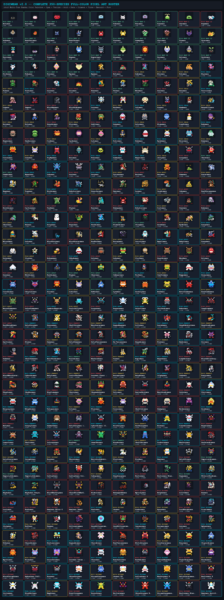
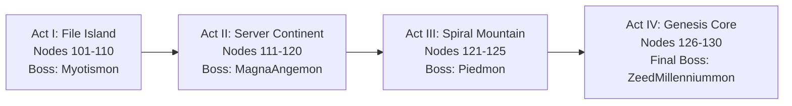

# DigiWear 📟⌚
### Dual-Device Standalone Wear OS Virtual Pet System & Android Companion Ecosystem

[](https://developer.android.com/wear)
[](https://kotlinlang.org)
[](https://developer.android.com/jetpack/compose)
[](https://github.com)
[](https://humulos.com/digimon/)
[](LICENSE)

---

## 🌟 Executive Summary

**DigiWear** is an authentic, standalone virtual pet ecosystem designed from the ground up for modern Wear OS smartwatches and paired with a feature-complete Android companion application. 

Recreating the golden era of handheld virtual pets (Generations V1 through V6, Pendulum, D-3, and Digimon X), DigiWear combines historical lifecycle simulation accuracy with modern smartwatch wearable hardware:
- **Standalone Wear OS Simulation**: Operates 100% autonomously on your wrist without requiring an active smartphone tether. Physiological stats calculate via real-time UTC Unix timestamp deltas.
- **Ultra-Low-Power Ambient Mode**: Custom monochrome outline shaders guarantee an On-Pixel Ratio (OPR ≤ 15%) for all-day battery endurance.
- **Physical Hardware Button Interception**: Sub-millisecond synchronous key dispatch intercepts watch stem buttons (`STEM_PRIMARY`, `STEM_1`, `STEM_2`, `STEM_3`), rotary crown, and volume keys for zero-latency sweet-spot Quick Time Events (QTEs).
- **Digimon 0nl1ne / D-Com / A-Com Compatibility**: Full cryptographic 128-bit Crockford Base32 Comm Code codec with HMAC-16 verification for offline and asynchronous pvp battles.
- **DNA Digivolution (Jogress) & DigiXros**: Canonical multi-partner fusions across both solo vault storage and friend Comm Codes without altering external wire protocol compliance.
- **30-Sector Adventure Campaign**: Connects real-world physical step tracking directly to narrative progression across 4 expansive story arcs with 28 boss checkpoints.
- **Rich Companion Android Hub**: DigiVault partner cryo-storage, 350-species animated Sprite Studio, Battle Hub & Code Scanner, Campaign Story Architect, Android Home Screen AppWidget, and remote watch settings sync.

---

## 🧬 Official Visual Sprite Sheet Digivolution & DNA Jogress Guide (All 350 Species)

Every single one of the **350 Digimon** in DigiWear is naturally reachable from the **10 Starter Digi-Eggs** via canonical Bandai 1997 V-Pet, Digimon Pendulum, and Digimon Color evolution rules, or via **65 DNA Jogress / DigiXros / Mode Change** combinations.

👉 **[Read the Complete Interactive Table & Guide (`DIGIVOLUTION_GUIDE.md`)](DIGIVOLUTION_GUIDE.md)**

### Visual Sprite Sheet Evolution & DNA Jogress Chart


### Master 350-Species Full-Color Pixel-Art Sprite Sheet


---

## ⌚ Universal Wear OS & Standalone AOSP Standard Watch Compatibility

DigiWear is engineered from the ground up to run natively on **both** Google **Wear OS 3.0–5.0+** smartwatches **and** standalone **AOSP / Full Android Standard Watches (FAWs)** running Android 9.0–15.0+ (including Kospet, Lokmat, Lemfo, Zeblaze, Rogbid, and generic round/square AOSP Android smartwatches without Google Play Services):

| Subsystem | Wear OS 3.0 / 4.0 / 5.0+ Watches | Standalone AOSP / Full Android Standard Watches |
| :--- | :--- | :--- |
| **APK Binary (`release_bin/`)** | `wear-os-app-release.apk` | `digiwear-aosp-standard-watch-release.apk` (or `wear-os-app-release.apk`) |
| **Manifest Hardware Flag** | `android.hardware.type.watch` (`required="false"`) | Installs cleanly via standard Android PackageInstaller / ADB without Wear OS flags |
| **Wearable Shared Library** | `<uses-library android:name="com.google.android.wearable" android:required="false" />` | Dynamically guarded via reflection in `AmbientController` — zero crash when absent |
| **Pedometer & Step Engine** | **Tier 1**: `Sensor.TYPE_STEP_COUNTER` / **Tier 2**: `TYPE_STEP_DETECTOR` | **Tier 3 Fallback**: Automatic **AOSP Wrist Accelerometer Gait Peak Detector** (`1.24g` threshold, `330ms` debounce) + `+100 Steps` bench button |
| **Display Geometry (`WatchDisplayConfig`)** | Round OLED inset padding (`isScreenRound = true`) + Ambient OPR ≤ 15% | Adaptive Square/Rectangular & High-DPI Round AOSP scaling + **Display Shape Override (`AUTO` / `ROUND` / `SQUARE`)** in Settings |
| **Hardware Buttons & Navigation** | `STEM_PRIMARY`, `STEM_1..3`, Rotary Bezel / Crown (`ACTION_SCROLL`) | Standard Android `VOLUME_UP` / `F1` (`[A]`), `ENTER` / `CAMERA` / `F2` (`[B]`), `BACK` / `ESCAPE` (`[C]`), native `BackHandler` edge-swipe support |
| **Phone-to-Watch Sync** | Google Play Services Wearable Data Layer (`/sync/*`) | **AOSP LAN Bridge**: Direct TCP port `45820` + UDP auto-discovery on port `45821` over local Wi-Fi or Phone Hotspot (zero GMS required) |
| **Multiplayer & Battles** | NFC Tap-to-Duel, Wild Barcode/NFC Scan, A-Com Relay, Comm Codes | NFC Tap-to-Duel (if hardware present), Optical/Barcode Wild Scan, and offline 16/26-char `DigiROM` / `CommCode` entry |

### AOSP Smartwatch Wi-Fi & Hotspot LAN Bridge
For Full Android Watches without Google Play Services:
1. Connect your AOSP smartwatch and your Android phone to the same Wi-Fi network (or turn on your phone's Wi-Fi Hotspot and connect your watch).
2. Open DigiWear on your watch, navigate to **Settings**, and locate **AOSP LAN BRIDGE** to see the watch's IP and port (e.g. `192.168.43.112:45820`).
3. Open the Companion App on your phone, head to **Pet Dashboard → Smartwatch Shell & Hardware Settings → AOSP / Android Watch Wi-Fi & Hotspot Bridge**, and tap **`🔍 LINK AOSP`**.
4. The companion app automatically broadcasts a UDP discovery probe on port `45821` to link your watch. If your watch has a static IP, you can also enter it manually. Once linked, all live state pulls, 1-tap Jogress beams, remote care actions, custom campaigns, and setting pushes sync in real-time over TCP.

### Display Shape Override for Round AOSP Watches
Many round AOSP watches (Kospet, Lokmat, Lemfo, Zeblaze) run customized smartphone ROMs where Android misreports `isScreenRound = false`. DigiWear provides a 1-tap **Display Shape Override** (`AUTO` / `ROUND` / `SQUARE`) in both the Watch Settings and Phone Companion App. Setting this to `ROUND` enforces circular OLED safety margins to prevent any UI truncation on circular bezels.

## 🏛 System Architecture

The project is structured into three decoupled, high-performance Gradle modules:

```mermaid
graph TD
    subgraph Core ["Shared Core Module (:shared-vpet-core)"]
        SE["PetSimulationEngine<br/>UTC Delta Life Decay Calculator"]
        EE["EvolutionEngine<br/>Multi-Variable Condition Evaluator"]
        JE["JogressEngine<br/>DNA & DigiXros Canonical Fusion Matrix"]
        CC["CommCodeCodec<br/>128-bit Crockford Base32 + HMAC-16"]
        BS["DeterministicBattleSolver<br/>PRNG Combat & 1.2x Elemental Triangle"]
        AE["AdventureEngine<br/>30-Sector Step Campaign Parser"]
        Catalog["PetSpecies Registry<br/>350 Authentic Species"]
    end

    subgraph WearApp ["Wear OS Smartwatch Application (:wear-os-app)"]
        WDC["WatchDisplayConfig<br/>Round & Square Display Geometry"]
        BG["BackgroundCanvas<br/>8 Selectable Themes + OLED Black"]
        UI_W["Wear Compose UI<br/>Authentic 3-Button [A][B][C] + Touch Mode"]
        HW["HardwareInputManager<br/>Stem Keys & Crown (Sub-ms QTE Interceptor)"]
        Canvas_W["Canvas Sprite Engine<br/>FilterQuality.None 64x64 Pixel Art"]
        Keypad["Crockford Base32 Keypad<br/>On-Wrist Comm Code Entry"]
        AM["LocalAmbientModeManager<br/>Monochrome Outline / OPR ≤ 15%"]
        WM["WorkManager PetDecayWorker<br/>Background Delta Processor"]
        Sensors["Step Tracker Manager<br/>TYPE_STEP_COUNTER Sensor"]
        Room_W[("Room DB: pet_state & adventure_state")]
    end

    subgraph PhoneApp ["Mobile Companion Smartphone Application (:phone-companion-app)"]
        UI_P["Material Design 3 Compose"]
        Vault["DigiVault Cryo-Storage<br/>Multi-Partner Preservation & Fusion"]
        Widget["Android Home Screen AppWidget<br/>Live Pixel Art & Physiological Meters"]
        Studio["350-Species Sprite Studio<br/>12-Frame Uniform Animation Viewer"]
        Hub["Battle Hub & Comm Code Scanner"]
        StoryEd["30-Sector Story Architect<br/>Custom JSON Campaign Editor"]
        Backup["Cloud JSON State Backup & Transfer"]
        Room_P[("Room DB: Synced History, Vault, Campaigns")]
    end

    SE --> Room_W
    EE --> Room_W
    JE --> Room_W
    CC --> Keypad
    Keypad --> UI_W
    BS --> UI_W
    AE --> Sensors
    WDC --> UI_W
    BG --> UI_W
    HW --> UI_W
    Catalog --> Canvas_W

    SE --> UI_P
    JE --> Vault
    CC --> Hub
    BS --> Hub
    AE --> StoryEd
    Catalog --> Studio
    Room_P --> Widget

    Room_W <--> |"Wearable Data Layer API<br/>/sync/update_settings & pet_state"| Room_P
```



---

## 🎮 Key Features & Gameplay Mechanics

### 1. Authentic V-Pet Lifecycle Simulation
State decay strictly follows the original Bandai virtual pet timing schedules based on real-world elapsed UTC time:

```
ΔT = Current_UTC_Time - Last_Processed_UTC_Time
```

| Life Stage | Hunger Loss | Strength Loss | Waste Interval | Sleep Window | Mistake Grace Window |
|---|---|---|---|---|---|
| **Baby I** | 3 Minutes | 3 Minutes | 15 Minutes | No Sleep (Active Continuous) | Exempt (Care Mistakes Disabled) |
| **Baby II** | 10 Minutes | 10 Minutes | 30 Minutes | 20:00 – 07:00 | 10 Minutes post-call signal |
| **Child** | 30 Minutes | 30 Minutes | 60 Minutes | 21:00 – 08:00 | 10 Minutes post-call signal |
| **Adult** | 45 Minutes | 45 Minutes | 90 Minutes | 22:00 – 08:00 | 15 Minutes post-call signal |
| **Perfect** | 60 Minutes | 60 Minutes | 120 Minutes | 23:00 – 09:00 | 15 Minutes post-call signal |
| **Ultimate** | 90 Minutes | 90 Minutes | 180 Minutes | 23:00 – 09:00 | 15 Minutes post-call signal |

- **Metabolic Sleep Preservation**: Turning off lights when the pet enters its designated sleep window halts hunger and strength decay clocks.
- **Care Mistakes**: Triggered only if hunger/strength calls or unextinguished sleep lights are ignored beyond the stage grace window.
- **Overfeeding Mechanic**: Feeding up to 5 additional meals beyond full satiety increases weight and fulfills specific evolution branch criteria without prematurely sickening the pet.
- **10 Starter Digi-Eggs**: Choose from Botamon (`#101`), Punimon (`#102`), Poyomon (`#103`), Yuramon (`#104`), Zurumon (`#105`), Mokumon (`#106`), Kuramon (`#107`), Pitchmon (`#108`), Nyokimon (`#109`), or Choromon (`#110`) upon birth or reset.

---

### 2. Hybrid Input System & Zero-Latency Hardware Buttons
DigiWear provides both classic physical handheld controls and modern touch ergonomics:

1. **Authentic 3-Button LCD Mode**:
   - Renders the iconic 8-icon Bandai LCD border:
     - Top row: `[🍖 FOOD]`, `[💡 LIGHT]`, `[⚔ BATTLE]`, `[🧹 FLUSH]`
     - Bottom row: `[📊 STATUS]`, `[🥊 TRAIN]`, `[💉 MEDS]`, `[🚨 ATTENTION]`
   - Dedicated on-screen touch buttons: `[A]` (Select/Cycle), `[B]` (Confirm/Execute), and `[C]` (Cancel/Back).
   - Direct touch on any of the 8 icons or active pet sprite remains fully responsive.
2. **Modern Touch Mode**:
   - Smooth `ScalingLazyColumn` interface optimized for quick wrist navigation.
3. **Hardware Key Interception (`HardwareInputManager`)**:
   - Direct native event dispatch on the main UI thread with sub-millisecond latency:
     - **Button A (Select / Next)**: `KEYCODE_STEM_1`, `KEYCODE_STEM_PRIMARY`, `KEYCODE_DPAD_UP`, `KEYCODE_VOLUME_UP`, Rotary Crown turn clockwise.
     - **Button B (Confirm / QTE Strike)**: `KEYCODE_STEM_2`, `KEYCODE_ENTER`, `KEYCODE_DPAD_CENTER`, `KEYCODE_SPACE`.
     - **Button C (Cancel / Back / Light)**: `KEYCODE_STEM_3`, `KEYCODE_BACK`, `KEYCODE_ESCAPE`.
     - **Previous**: Rotary Crown turn counter-clockwise, `KEYCODE_DPAD_DOWN`, `KEYCODE_VOLUME_DOWN`.
4. **Dual Training Modes (OG QTE & Pendulum Shake)**:
   - **Original QTE Timing Bar**: Fast-oscillating power bar where hitting Button B or tapping inside the 80%–100% sweet spot smashes 5/5 iron blocks to grant maximum Effort and Strength.
   - **Authentic Pendulum Shake**: Powered by real-time hardware accelerometer (`Sensor.TYPE_ACCELEROMETER`). Shake your wrist 5–8 times (Bandai Pendulum sweet spot) within a 3-second countdown window with haptic feedback ticks on each detected stroke. Features strict `DisposableEffect` sensor lifecycle management (0% idle battery consumption in ambient mode).
   - Switchable at any time from Watch Settings or Companion App Settings.
5. **Authentic 8-Bit Bandai Piezo Buzzer Sound Engine**:
   - Faithful recreation of the classic 4-beep attention call (`pip-pip-pip-pip`), button clicks, hit chirps, and 8-bit victory fanfares via low-overhead `ToneGenerator`.
   - Toggleable directly in Watch Settings or Companion App Settings (muted by default for discreet wrist wear).
6. **Battle Critical Strike Reflex Window**:
   - A 500ms reflex window during combat rounds that grants a +25% Critical Strike boost on physical keypress or screen tap.

---

### 3. Full-Color Sprite Engine (350 Authentic Species)
Every monster is rendered via a uniform 64 × 64 px matrix canvas at `FilterQuality.None` for crisp, authentic pixel art across round and square screens, with 350 unique bespoke 16 × 16 multi-tone matrices and 350 canonical color palettes:

```
+-----------------------------------------------------------------------+
| Row 0: [Idle Stance A]    | [Idle Stance B]    | [Walking Motion A]   |
| Row 1: [Walking Motion B] | [Feeding Start]    | [Chewing / Joy]      |
| Row 2: [Sleeping Frame A] | [Sleeping Frame B] | [Refusal / Displeased|
| Row 3: [Attack Charge]    | [Attack Release]   | [Injury / Sick State]|
+-----------------------------------------------------------------------+
```

#### Roster Distribution (350 Species):
- **Baby I (10 — `#101`–`#110`)**: Botamon, Punimon, Poyomon, Yuramon, Zurumon, Mokumon, Kuramon, Pitchmon, Nyokimon, Choromon.
- **Baby II (24 — `#111`–`#129`, `#130`–`#134`)**: Koromon, Tsunomon, Tokomon, Tanemon, Pagumon, DemiMeramon, DemiVeemon, Gigimon, Viximon, Gummymon, Chocomon, Yaamon, Bukamon, Pyocomon, Kapurimon, Nyaromon, Dorimon, Minomon, Hopmon, Tsumemon, Moonmon, Sunmon, Poromon, Upamon.
- **Child (60 — `#201`–`#260`)**: Agumon, Betamon, Gabumon, Elecmon, Patamon, Biyomon, Palmon, Tentomon, Gazimon, Gizamon, Kunemon, Veemon, Wormmon, Guilmon, Renamon, Terriermon, Lopmon, Impmon, BlackAgumon, BlackGabumon, Lucemon, Hackmon, Salamon, Gaomon, Hawkmon, Armadillomon, Dorumon, Kotemon, Monodramon, Floramon, Goblimon, Gomamon, Gotsumon, Otamamon, Candlemon, Bakumon, Hagurumon, Mushroomon, Crabmon, Syakomon, Lalamon, Falcomon, Kudamon, Ryudamon, Dracomon, Kamemon, Coronamon, Lunamon, ToyAgumon, Keramon, Pulsemon, Gammamon, Angoramon, Jellymon, Loogamon, Shoutmon, Gumdramon, Agunimon, Lobomon, Gazimon (Modern).
- **Adult (87 — `#301`–`#387`)**: Greymon, Tyrannomon, Devimon, Meramon, Numemon, Garurumon, Angemon, Togemon, Birdramon, Kabuterimon, Monochromon, Ogremon, Leomon, Seadramon, Sukamon, DarkTyrannomon, Devidramon, Cyclonemon, Tuskmon, Flymon, Raremon, Kuwagamon, Kokatorimon, Coelamon, Nanimon, Bakemon, Shellmon, Unimon, Frigimon, Vegiemon, Veedramon, Flamedramon, Stingmon, Growlmon, Kyubimon, Gargomon, Wizardmon, Gatomon, BlackGreymon, BlackGarurumon, BaoHackmon, Dorugamon, Sorcerymon, Aquilamon, Ankylomon, Gaogamon, Mojyamon, Starmon, Dokugumon, Ikkakumon, Golemon, Gekomon, Clockmon, Guardromon, Woodmon, Octomon, Gesomon, Ebidramon, Raidramon, Digmon, Shurimon, Submarimon, Peckmon, Sunflowmon, Reppamon, Ginryumon, Coredramon, Chrysalimon, Firamon, Lekismon, ExVeemon, Lynxmon, GeoGreymon, Bulkmon, BetelGammamon, KausGammamon, WezenGammamon, GulusGammamon, SymbareAngoramon, TeslaJellymon, Loogarmon, Pegasusmon, Nefertimon, Strikedramon, Dobermon, Sangloupmon, DarkKnightmon.
- **Perfect (77 — `#401`–`#477`)**: MetalGreymon, Monzaemon, SkullGreymon, WereGarurumon, MagnaAngemon, Lillymon, Garudamon, MegaKabuterimon, MegaSeadramon, Myotismon, Etemon, Mamemon, MetalMamemon, MetalTyrannomon, Ex-Tyrannomon, Megadramon, Piximon, Andromon, Giromon, Vademon, SkullMamemon, AeroVeedramon, Paildramon, WarGrowlmon, Taomon, Rapidmon, Angewomon, LadyDevimon, BlackMetalGreymon, BlackWereGarurumon, Cyberdramon, Antylamon, SaviorHackmon, Lucemon Chaos Mode, Dorugreymon, Knightmon, Silphymon, Zudomon, Shakkoumon, Dinobeemon, Cherrymon, Garbagemon, Digitamamon, ShogunGekomon, Volcamon, MarineDevimon, Triceramon, Infermon, Chirinmon, Hisyaryumon, Wingdramon, Yatagaramon, MachGaogamon, Flaremon, Crescemon, SkullSatamon, Mummymon, Arukenimon, Grademon, Astamon, Gargoylemon, Mammothmon, MetalGreymon (Virus), Cyberdramon (Savers), RizeGreymon, MachGaogamon (Savers), Boutmon, Canoweissmon, Regulusmon, Lamortemon, Thetismon, Soloogarmon, Baalmon, JewelBeemon, Dinobeemon (Chimera), SkullMeramon, Cerberusmon.
- **Ultimate & Super Ultimate (92 — `#501`–`#592`)**: WarGreymon, Machinedramon, MetalGarurumon, Seraphimon, Rosemon, Phoenixmon, HerculesKabuterimon, Plesiomon, Piedmon, Omnimon, MetalEtemon, Imperialdramon Dragon Mode, Imperialdramon Fighter Mode, Imperialdramon Paladin Mode, Gallantmon, Gallantmon Crimson Mode, Sakuyamon, MegaGargomon, Beelzemon, Beelzemon Blast Mode, Magnamon, UlforceVeedramon, Alphamon, Alphamon Ouryuken, BlackWarGreymon, ChaosBlackWarGreymon, Diaboromon, Armaggeddemon, Apocalymon, Belphemon, Lilithmon, Daemon, Leviamon, Barbamon, Omnimon Alter-S, Omnimon Zwart, Mastemon, Jesmon, Gankoomon, Dynasmon, LordKnightmon, Craniummon, Sleipmon, Duftmon, Examon, Millenniummon, MoonMillenniummon, ZeedMillenniummon, Susanoomon, Dorugoramon, Gaiomon, Ophanimon, Vikemon, Chaosdramon, Kentaurosmon, Magnadramon, Cherubimon, RustTyrannomon, BlitzGreymon, CresGarurumon, Ouryumon, Slayerdramon, Apollomon, Dianamon, GraceNovamon, Lucemon Satan Mode, Chaosmon, BanchoLeomon, Darkdramon, MarineAngemon, TigerVespamon, Kuzuhamon, BlackSeraphimon, Ophanimon Falldown Mode, Ravemon, ShineGreymon, MirageGaogamon, Jesmon GX, Gallantmon X, WarGreymon X, MetalGarurumon X, Beelzemon X, Siriusmon, Diarbbitmon, Amphimon, Fenriloogamon, Kazuchimon, Arcturusmon, ShineGreymon Burst Mode, MirageGaogamon Burst Mode, Beelzemon Blast Mode (Apex), Omnimon Merciful Mode.

---

### 4. DNA Digivolution (Jogress) & DigiXros Architecture

DigiWear introduces authentic DNA Digivolution and DigiXros mechanics **without compromising compatibility with Digimon 0nl1ne, D-Com, and A-Com**:

#### Why Wire Compatibility is 100% Preserved:
In online battle simulators and physical 2-pin / 3-pin handheld communicators, communication packets contain only the **active combatant's current parameters**:

```
Payload = { MonsterID, Stage, Attribute, BasePowerHP, Victories, Effort, Seed, Salt, HMAC }
```
Because external simulators inspect only the resulting species, Omnimon (`#510`), Paildramon (`#423`), and Mastemon (`#537`) transmit as standard canonical monsters with valid base power, Stage 6 (Ultimate), and elemental attributes.

#### Canonical Fusion Catalog (65 Total Recipes — Featured Highlights):

| Target Species | Stage | Attribute | Fusion Recipe | Type |
|---|---|---|---|---|
| **Omnimon** (`#510`) | Ultimate | Vaccine | WarGreymon (`#501`) + MetalGarurumon (`#503`) | DNA Jogress |
| **Omnimon Zwart** (`#536`) | Ultimate | Vaccine | BlackWarGreymon (`#525`) + BlackWereGarurumon (`#430`) | DNA Jogress |
| **Omnimon Alter-S** (`#535`) | Ultimate | Vaccine | BlitzGreymon (`#559`) + CresGarurumon (`#560`) / WarGreymon (`#501`) + Machinedramon (`#502`) | DNA Jogress / Xros |
| **Paildramon** (`#423`) | Perfect | Free | ExVeemon (`#371`) / Flamedramon (`#332`) / Veedramon (`#331`) + Stingmon (`#333`) | DNA Jogress |
| **Silphymon** (`#437`) | Perfect | Free | Gatomon (`#338`) / Gaogamon (`#346`) + Aquilamon (`#344`) | DNA Jogress |
| **Shakkoumon** (`#441`) | Perfect | Free | Angemon (`#307`) + Ankylomon (`#345`) | DNA Jogress |
| **Imperialdramon DM** (`#512`) | Ultimate | Free | Paildramon (`#423`) + MetalGreymon (`#401`) / Megadramon (`#416`) | Mode Change |
| **Imperialdramon PM** (`#514`) | Super Ult | Vaccine | Imperialdramon FM (`#513`) + Omnimon (`#510`) | Mode Change |
| **Mastemon** (`#537`) | Ultimate | Vaccine | Angewomon (`#427`) + LadyDevimon (`#428`) | DNA Jogress |
| **GraceNovamon** (`#565`) | Super Ult | Vaccine | Apollomon (`#563`) + Dianamon (`#564`) | DNA Jogress |
| **Chaosmon** (`#567`) | Super Ult | Vaccine | BanchoLeomon (`#568`) + Darkdramon (`#569`) | DNA Jogress |
| **Jesmon GX** (`#578`) | Super Ult | Data | Jesmon (`#538`) + Gankoomon (`#539`) | DigiXros |
| **Examon** (`#545`) | Super Ult | Data | Wingdramon (`#451`) + Slayerdramon (`#562`) | DNA Jogress |
| **RustTyrannomon** (`#558`) | Ultimate | Virus | MetalTyrannomon (`#414`) + Volcamon (`#445`) | DigiXros |
| **Millenniummon** (`#546`) | Ultimate | Virus | Machinedramon (`#502`) + DarkTyrannomon (`#316`) | DNA Jogress |
| **MoonMillenniummon** (`#547`)| Ultimate | Virus | Millenniummon (`#546`) + Diaboromon (`#527`) | Mode Change |
| **ZeedMillenniummon** (`#548`)| Super Ult | Virus | MoonMillenniummon (`#547`) + Apocalymon (`#529`) | DNA Jogress |
| **Alphamon Ouryuken** (`#524`) | Super Ult | Vaccine | Alphamon (`#523`) + Ouryumon (`#561`) / Cyberdramon (`#431`) | DigiXros |
| **Gallantmon CM** (`#516`) | Super Ult | Vaccine | Gallantmon (`#515`) + Phoenixmon (`#506`) / AeroVeedramon (`#422`) | Mode Change |
| **Gallantmon X** (`#579`) | Super Ult | Vaccine | Gallantmon (`#515`) + Dorumon (`#227`) | Mode Change |
| **Beelzemon BM** (`#520`) | Super Ult | Virus | Beelzemon (`#519`) + Andromon (`#418`) / Megadramon (`#416`) | DigiXros |
| **Apocalymon** (`#529`) | Super Ult | Free | Piedmon (`#509`) + Machinedramon (`#502`) | DNA Jogress |
| **Susanoomon** (`#549`) | Super Ult | Vaccine | WarGreymon (`#501`) + Magnamon (`#521`) | DNA Jogress |

#### Easy 1-Tap Jogress, DigiXros & Mode Change (Across Watch & Phone):
1. **Watch Status Screen Chamber (`StatusScreen.kt`)**: Scroll to `EVO GUIDE & LINEAGE` on your wrist. Whenever your active partner matches a fusion recipe, the **⚡ DNA JOGRESS / DIGIXROS READY** chamber renders the `[Partner Sprite] → [Target Sprite]` equation with a 1-tap **`⚡ FUSE`** button right on the watch. If your Digimon is a lower stage (Child/Adult), it displays a **Next Stage Jogress / Xros Unlocks** preview so you know what to aim for.
2. **Watch Battle Transceiver (`BattleScreen.kt`)**: Below the CommCode input keypad, the **⚡ DNA JOGRESS / DIGIXROS** matrix card automatically lists all recipes for your active partner with **`[CODE]`** (auto-populates partner 128-bit CommCode) and **`[⚡FUSE]`** (1-tap fusion execution with fanfare).
3. **Phone Dashboard Fusion Chamber (`PetDashboardScreen.kt`)**: The main dashboard contains a dedicated **`▸ ⚡ DNA JOGRESS, DIGIXROS & MODE CHANGE CHAMBER`** showing 3-sprite equations (`[Active] + [Partner] ══▶ [Target]`) with a 1-tap **`⚡ AWAKEN & BEAM TO WATCH`** button that awakens the evolved form and syncs it immediately to your wrist. Also includes a toggleable 65-recipe catalog.
4. **Phone Battle Hub Live Auto-Decoder (`BattleHubScreen.kt`)**: Entering or scanning a friend's CommCode automatically decodes the species and immediately reveals the **⚡ DNA DIGIVOLVE WITH FRIEND'S CODE!** button without having to fight a match first. In addition, 1-tap partner code chips are provided for instant loading.
5. **Phone Cryo-Vault Fusion Lab (`DigiVaultScreen.kt`)**: Displays all compatible partner recipes for your active Digimon with **`+VAULT`** (spawns partner into storage) and **`⚡ FUSE`** (opens interactive 3-way fusion awakening dialog and beams the result to your watch).

> 📖 **Complete 350-Species Digivolution Guide & Lineage Chart**: See [**`DIGIVOLUTION_GUIDE.md`**](DIGIVOLUTION_GUIDE.md) for the complete stage-by-stage evolution requirements, Starter Digi-Egg paths, and all 65 DNA Jogress / Mode Change recipes.

---

### 5. 4-Mode Battle System, Canonical V-Pet Formulas & 128-Bit Comm Code

DigiWear features **full face-to-face animated battle rendering** (`flipHorizontal = true` on the left fighter so both Digimon face each other, animated projectile clashes `●━━▶` / `⚡MEGA HIT⚡`, live HP bars, and QTE reflex boosts) across **4 distinct, separated Battle Modes** on both Watch and Phone:

1. **🏟 Mode 1 — Adventure Colosseum (`BattleMode.ADVENTURE`)**:
   - 30-Sector Pedometer Quest & Colosseum Boss Gates with sector weather hazards (`Thunderstorm`, `Magma Heat`, `Tidal Current`, `Miasma Fog`, `Zero Gravity`, `Apocalymon Void`) and live turn-by-turn face-to-face arena combat.
2. **📡 Mode 2 — Wild NFC & Barcode Scanner (`BattleMode.WILD_SCAN`)**:
   - Scan any physical NFC tag/card/transit pass/amiibo on Watch or Phone, or scan/enter any **UPC/EAN-13 product barcode or QR code** in the Companion App (`WildScanEncounterGenerator`) to deterministically discover Wild Digimon scaled to a Digital World Habitat Zone (`File Island Coast`, `Folder Continent`, `Net Ocean Trench`, `Dark Area Abyss`), with an 18% Rare Boss Anomaly escalation!
3. **📶 Mode 3 — NFC Tap-to-Duel P2P (`BattleMode.NFC_TAP_DUEL`)**:
   - Tap Watch-to-Watch, Watch-to-Phone, or Phone-to-Phone via NFC Reader/NDEF (`application/vnd.com.digiwear.battle`) or 128-bit Crockford Base32 CommCodes for instant peer-to-peer duels and DNA Jogress fusions.
4. **🌐 Mode 4 — A-Com / D-Com / WiFiCom + Watch NFC Relay (`BattleMode.ACOM_DCOM_WIFICOM`)**:
   - Full `V1-XXXX-XXXX-XXXX` (48-bit) and `V1-XXXX-XXXX` (32-bit) DigiROM transceiver for Digimon 0nl1ne, w0rld, Alpha Terminal, A-Com, D-Com, and WiFiCom.
   - **Watch-to-Phone NFC & DataLayer Relay**: Tap your Smartwatch to your Phone (or tap **`📲 RELAY DIGIROM TO PHONE`** on the Watch) to bridge your Watch Partner's live DigiROM into the Phone Companion App's A-Com / WiFiCom Online Tamer Lobby, and beam opponents right back to your wrist!

#### Canonical Bandai V-Pet Battle Formulas (`DeterministicBattleSolver`):
- **Effective Power (`EFF PWR`)**: `BasePower + (Effort × 8) + min(Victories, 50) × 2 + StageBonus`
- **Hit Rate (`HIT%`)**: `clamp(50% + ((AttackerEffPower - DefenderEffPower) / (AttackerEffPower + DefenderEffPower)) × 35% + AttributeBonus(±10%) + CritBoost(+12%), 20%, 95%)`
- **Attack Tiers**:
  - `SINGLE` (Standard Shot)
  - `DOUBLE` (Twin Barrage on favorable PRNG roll)
  - `MEGA_HIT` (Triggered by QTE / Pendulum Shake Reflex Boost `+25%` or natural Critical Strike `1.35×`)
- **Elemental Triangle (`1.2×` Damage & `+10%` Hit Rate)**: `Vaccine > Virus > Data > Vaccine` (`Free` is neutral).
- **Environmental Sector Modifiers (`1.15×` Damage)**: Weather hazards amplify matching elemental attributes during Adventure & Wild Scan battles.

#### Bit Allocation Table (128 Bits / 16 Bytes):
```
Bit 000-007: Protocol Version (8-bit, 0x01)
Bit 008-023: Monster ID (16-bit, species index 101..558)
Bit 024-027: Stage Index (4-bit, 0x1=Baby I .. 0x6=Ultimate)
Bit 028-031: Attribute (4-bit, 0=Vaccine, 1=Data, 2=Virus, 3=Free)
Bit 032-047: Base Power / HP (16-bit)
Bit 048-063: Historical Victories (16-bit)
Bit 064-079: Training Effort (16-bit)
Bit 080-095: Battle PRNG Seed (16-bit)
Bit 096-111: Timestamp Salt (16-bit)
Bit 112-127: HMAC-16 Cryptographic Checksum (16-bit)
```

---

### 6. 30-Sector Step Adventure Campaign

Connects real physical movement from the smartwatch step counter (`TYPE_STEP_COUNTER`) to a grand 30-Sector campaign spanning the iconic eras of the Digital World:



- **Persistent Hardware Step Baseline**: `StepTrackerManager` persists the hardware step counter baseline in `SharedPreferences` across app restarts and screen-off periods (automatically detecting device reboots), ensuring every background step is credited toward sector progression.
- **Deterministic Boss & Wild Encounter Combat**: Both Sector Boss gates and random Wild Digimon encounters resolve real turn-by-turn combat via `DeterministicBattleSolver` (`[B]` button or touch), crediting victories directly toward partner evolution requirements.
- **Environmental Weather Hazards**: Dynamic hazards (`glitch_fog`, `subzero_frost`, `pyroclastic_flow`, `cosmic_nihilism`) alter elemental combat damage variables in real time.
- **Boss Clear Flags**: Defeating sector bosses awards permanent campaign progress flags (`FLAG_INFINITY_CLEARED`, `FLAG_GENESIS_CLEARED`).

---

### 7. Companion App, DigiVault, DigiDex & Home Screen Widget

The mobile application (`:phone-companion-app`) serves as a full-featured management hub connected via 6 bidirectional Wearable Data Layer endpoints (`/sync/request_pet_state`, `/sync/response_pet_state`, `/sync/update_pet_state`, `/sync/update_settings`, `/sync/battle_code`, `/sync/campaign_data`):
- **DigiVault Cryo-Preservation**: Archive raised Digimon in zero-decay cryostasis. Browse stored partners with live animated pixel art, search/filter by stage, deploy back to the watch & phone dashboard with one click, or generate dual 128-bit Base32 Comm Codes and `V1-XXXX-XXXX-XXXX` DigiROM packets.
- **Android Home Screen AppWidget**: Built with standard `RemoteViews` rendering the live 64 × 64 color pixel-art sprite, stage, weight, hunger hearts (`♥♥♥♥`), and strength stars (`★★★★`). Refreshes automatically on watch sync, DigiDex morph, DNA Jogress fusion, backup restore, and DigiVault deployment.
- **350-Species DigiDex, Evolution Encyclopedia & 6-Mode Sprite Studio**: Search and filter all 350 species by stage or ID, inspect all 12 animation frames across 6 live preview modes (`IDLE`, `WALK`, `FEED`, `SLEEP`, `ATTACK`, `STATUS`) with authentic V-Pet pixel overlays, browse interactive pre-evolutions, branching evolutions, and DNA Jogress recipes, and morph your active partner or synthesize into DigiVault.
- **30-Sector Story Architect**: Create and customize custom campaign sagas and push them directly to the watch's active adventure engine via `/sync/campaign_data`.
- **JSON Cloud Portability**: Export and import either single `PetState` JSON snapshots or a Full Companion Archive (`FullCompanionArchive`: Active Pet + DigiVault Cryo-Storage + Custom Campaigns) with one-click JSON backup and restore.
- **Remote Watch Settings & Live Pull Sync**: Wirelessly pull live `PetState` from the watch or push 5 authentic LCD & shell themes (`classic_vpet_lcd`, `amber_pendulum_lcd`, `digivice_ic_blue`, `file_island_day`, `dark_oled_minimal`), haptic vibration motor, 1997 piezo chiptune buzzer, 3-button mode, and pendulum shake mode.

---

## 🛠 Tech Stack & Dependencies

| Layer | Component | Version / Technology |
|---|---|---|
| **Core Language** | Kotlin | `1.9.22` (JVM 17 Target) |
| **Wear OS UI** | Jetpack Compose for Wear OS | `1.3.0` (`ScalingLazyColumn`, `ScreenScaffold`) |
| **Companion UI** | Jetpack Compose (Material 3) | `1.6.2` / `material3:1.2.0` |
| **Persistence** | Room SQLite Persistence | `2.6.1` (KSP schema compiler) |
| **Background Work** | WorkManager | `2.9.0` (Periodic delta processor) |
| **Serialization** | Kotlinx Serialization | `1.6.3` (JSON payload contracts) |
| **Hardware Keys** | Android Input Framework | `KeyEvent` Main Thread Interceptor |
| **Wearable Sync** | Google Play Services Wearable | `18.1.0` (Data Layer API) |
| **Testing** | JUnit 4 + Coroutines Test | Unit & cryptographic validation |

---

## 🚀 Building & Sideloading

### Prerequisites
- **Android Studio** (Hedgehog 2023.1.1 or newer recommended)
- **JDK 17** (Bundled JetBrains Runtime `jbr` or OpenJDK 17)
- **Android SDK API 34** (Wear OS minSdk 26, Phone minSdk 26)

### 1. Compile and Test All Modules
To compile, run unit tests, and assemble both Debug and Release APKs:

```bash
# On Linux / macOS
./gradlew test assembleDebug assembleRelease

# On Windows PowerShell / Command Prompt
.\gradlew.bat test assembleDebug assembleRelease
```

### 2. Output Binaries

All modules assemble cleanly with 0 errors:

| Module | Build Variant | Size | Output File Location |
|---|---|---|---|
| **Wear OS & AOSP Smartwatch** | Release (Signed) | **21.05 MB** | `wear-os-app/build/outputs/apk/release/wear-os-app-release.apk` *(also in `release_bin/`)* |
| **Wear OS & AOSP Smartwatch** | Debug | **26.14 MB** | `wear-os-app/build/outputs/apk/debug/wear-os-app-debug.apk` *(also in `release_bin/`)* |
| **Phone Companion** | Release (Signed) | **12.09 MB** | `phone-companion-app/build/outputs/apk/release/phone-companion-app-release.apk` *(also in `release_bin/`)* |
| **Phone Companion** | Debug | **17.67 MB** | `phone-companion-app/build/outputs/apk/debug/phone-companion-app-debug.apk` *(also in `release_bin/`)* |

---

### 3. Sideloading to Devices

#### ⚡ Automated One-Click Sideloading Companion Scripts (Recommended):
DigiWear includes interactive helper scripts that automatically locate `adb` on your system (checking PATH and default Android SDK folders), assist with Wi-Fi pairing/connecting, and install both signed APKs without manual terminal commands:

- **Windows (Double-Click or Command Line)**:
  ```cmd
  sideload.bat
  ```
  *(Or in PowerShell: `.\sideload.ps1`)*

- **macOS / Linux**:
  ```bash
  chmod +x sideload.sh
  ./sideload.sh
  ```

The wizard guides you through:
1. Detecting connected devices via USB or wireless Wi-Fi.
2. Entering your watch's IP and port (e.g., `192.168.1.50:5555`) or 6-digit Wi-Fi pairing code.
3. Automatically installing the latest signed release APKs with proper replace (`-r`) and downgrade (`-d`) flags.

---

#### Manual Sideloading via Standard ADB:

##### Sideloading to Wear OS or AOSP Smartwatch via ADB over Wi-Fi:
1. On your smartwatch, enable **Developer Options** (Settings → System → About → tap *Build Number* 7 times).
2. Under Developer Options, enable **ADB Debugging** and **Debug over Wi-Fi**.
3. Note the IP address and pairing port shown on the watch.
4. From your terminal:
   ```bash
   adb pair <WATCH_IP>:<PAIRING_PORT>
   adb connect <WATCH_IP>:<CONNECT_PORT>
   adb -s <WATCH_IP>:<CONNECT_PORT> install -r wear-os-app/build/outputs/apk/release/wear-os-app-release.apk
   ```

##### Installing Phone Companion App:
Connect your Android phone via USB with USB Debugging enabled:
```bash
adb install -r phone-companion-app/build/outputs/apk/release/phone-companion-app-release.apk
```

---

## 🧪 Verification & Test Suite

The shared core logic includes complete unit test coverage across 9 dedicated test suites:
- **`SpriteMatrixRegistryTest`**: Audits all 350 species for 16 × 16 bounds, valid pixel character tokens, non-hollow multi-tone fills, zero duplicate matrices, zero duplicate palettes, 12-frame stance differentiation, and Ambient Mode On-Pixel Ratio (OPR ≤ 15%).
- **`RosterAuditTest`**: Audits all 350 species for ID-to-stage integrity, evolution graph validity, Perfect → Ultimate ascension criteria (≥ 3 days age, ≥ 25 battles), all 65 Jogress/DigiXros recipes, and 100% Digimon 0nl1ne / D-Com wire roundtrip compatibility.
- **`ExpandedRosterTest`**: Validates roster stage distribution and starter Digi-Egg evolutionary trees.
- **`CommCodeCodecTest`**: 128-bit payload binary serialization, Crockford Base32 alphabet validation, error-tolerant character mapping (`O` → `0`, `I`/`L` → `1`), and HMAC-16 tamper detection.
- **`DeterministicBattleSolverTest`**: Combined PRNG seed turn reproducibility, 1.2× elemental advantage damage calculations, +25% QTE Critical Strike reflex boost, environmental weather hazard modifiers, and 10-round combat termination.
- **`PetSimulationEngineTest`**: Physiological decay math across all 6 stages, metabolic sleep freezing, and care mistake grace windows.
- **`EvolutionEngineTest`**: Multi-variable branching evolution evaluation across age, care mistakes, effort, overfeeds, and battle win ratios.
- **`AdventureEngineTest`**: 30-node step accumulation, hazard weather mechanics, and final boss victory flag recording (`Node 130` ZeedMillenniummon).
- **`JogressEngineTest`**: Commutative fusion recipe matching (WarGreymon + MetalGarurumon == MetalGarurumon + WarGreymon → Omnimon), inherited stat bonuses, and Digimon 0nl1ne Comm Code roundtrip verification.

Execute tests via:
```bash
./gradlew test
```

---

## 🤝 Contributing

Contributions, bug reports, and sprite submissions are welcome!
1. Fork the repository.
2. Create your feature branch (`git checkout -b feature/NewFeature`).
3. Commit your changes (`git commit -m 'Add NewFeature'`).
4. Ensure all unit tests pass: `./gradlew test`.
5. Push to your branch (`git push origin feature/NewFeature`).
6. Open a Pull Request.

---

## 📜 Disclaimer & Acknowledgments

- **Digimon** and all associated characters, names, and assets are trademarks of **Bandai**, **Toei Animation**, and **Akiyoshi Hongo**.
- This project is an open-source fan recreation developed for non-commercial educational and preservation purposes.
- Special thanks to the virtual pet and emulation communities:
  - **[Humulos (Digital Monster Reference Engine)](https://humulos.com/digimon/)** for comprehensive lifecycle parameters and evolution branch data.
  - **[The Spriters Resource](https://www.spriters-resource.com/lcd_handhelds/)** for LCD sprite archives.
  - **[GMMan / DigimonColorSpriteTool](https://github.com/GMMan/DigimonColorSpriteTool)** for color sprite extraction tools.
  - **[ultramcu / acom-digimon](https://github.com/ultramcu/acom-digimon)** & **Digimon 0nl1ne** for physical signal and Comm Code protocol research.

---

<p align="center">
  <b>Built with ❤️ for Virtual Pet Trainers Worldwide</b>
</p>
